# 📘 SRS — La Vaquita

**Especificación de Requisitos de Software** · basada en IEEE 830 / ISO/IEC/IEEE 29148 (versión ligera para hackathon)

| Campo | Valor |
| :--- | :--- |
| Proyecto | **La Vaquita** — Inventario rápido y compras colectivas para tienditas |
| Evento | HackaPony 2026 · Reto 01: Comercio Local y PyMEs · Instituto Tecnológico de Morelia |
| Equipo | REYES (Reyes 3): Hiram, Alvaro, Jesús, Sebastían |
| Versión | 1.0 |
| Fecha | 2026-11-19 |
| Documentos relacionados | [`context.md`](../context.md) (reto y rúbrica) · [`plan.md`](../plan.md) (roles y cronograma) · `README.md` |

---

## 🤖 0. Guía para agentes y desarrolladores

Este documento es la **fuente de verdad** de qué se construye. Si vas a escribir código (persona o agente de IA):

1. **Ubica tu requisito por ID** (`RF-INV-03`, `RN-02`, etc.) y cítalo en tu commit/PR: `feat(inventario): alerta bajo stock [RF-INV-04]`.
2. **Respeta los contratos de módulo** de la §6. No cambies firmas ni el modelo de datos (§5.3) sin avisar al equipo; si lo cambias, **actualiza este documento en el mismo PR**.
3. **Trabaja solo dentro del módulo asignado** (§4.2). Entre módulos se importa únicamente desde `@/modules/<módulo>` (su `index.ts`).
4. **Las reglas de negocio (§3.3) mandan.** Si la UI y una regla chocan, gana la regla.
5. **Prioridad MoSCoW:** haz todos los `MUST` antes de tocar un `SHOULD`; los `COULD` solo después del *feature freeze* si hay tiempo… y no, después del freeze no hay tiempo.
6. **Criterio de terminado:** un requisito está hecho cuando pasan sus criterios de aceptación (§3 y §8) **en el deploy**, no solo en local.
7. Lo marcado como **Fuera de alcance (§9)** no se implementa aunque parezca fácil.

---

## 1. Introducción

### 1.1 Propósito
Definir los requisitos funcionales, no funcionales, reglas de negocio, arquitectura de componentes e interfaces del prototipo **La Vaquita**, para que los 4 integrantes y sus agentes de IA desarrollen en paralelo y de forma modular, sin ambigüedad, dentro de las 8 horas del hackathon.

### 1.2 Problema
Las tienditas de abarrotes de colonia en México compran insumos **al menudeo** y pierden margen frente a cadenas (OXXO, supermercados) que compran por volumen. Además, no tienen un control ágil de qué productos están por agotarse, lo que provoca quiebres de stock y compras de emergencia caras.

### 1.3 Alcance
La Vaquita es una **aplicación web responsiva (mobile-first)** donde comerciantes de una misma colonia:

- registran su **inventario básico** (entradas/salidas) y reciben **alertas visuales** de bajo stock;
- crean o se unen a **"vaquitas"** (canastas de compra colectiva) para sumar unidades de un producto hasta alcanzar la **meta de mayoreo** y obtener el precio de volumen;
- ven **cuánto ahorran** al comprar en grupo.

El nombre viene de la expresión mexicana *"hacer la vaquita"*: juntarse entre varios para pagar algo.

### 1.4 Definiciones y acrónimos

| Término | Definición |
| :--- | :--- |
| **Tienda** | Comercio de colonia que usa el sistema (abarrotes, miscelánea). |
| **Tendero(a)** | Persona que opera la tienda; usuario principal. |
| **Producto** | Artículo del catálogo global (ej. "Coca-Cola 600 ml"). Es el mismo para todas las tiendas. |
| **Inventario** | Stock de un producto en una tienda concreta. |
| **Movimiento** | Registro de ENTRADA (surtir) o SALIDA (venta/merma) de unidades. |
| **Stock mínimo** | Umbral por debajo del cual el producto se considera bajo. |
| **Vaquita / Canasta** | Pedido grupal de un producto con una meta de unidades y un precio de mayoreo. En código: `Canasta`. |
| **Aportación** | Unidades que una tienda compromete a una vaquita. |
| **Meta de mayoreo** | Unidades totales necesarias para obtener el precio de mayoreo. |
| **Tienda actual** | Tienda con la que el usuario "entró" (guardada en cookie). |
| **MVP** | Producto Mínimo Viable exigido por el reto. |
| **MoSCoW** | Prioridad: MUST (obligatorio), SHOULD (importante), COULD (deseable), WON'T (no se hará). |

### 1.5 Requisitos del reto (origen)
Del `context.md`, el MVP **obligatorio** es:

| ID reto | Requisito oficial | Cubierto por |
| :--- | :--- | :--- |
| **R1** | Catálogo simple con control de stock (entradas/salidas y alerta visual de bajo inventario) | RF-INV-01 … RF-INV-05 |
| **R2** | Módulo de "Pedido Grupal" donde 2 o más tiendas suman unidades hasta completar la meta de mayoreo | RF-VAQ-01 … RF-VAQ-06 |
| **R3** | Demo funcional con datos simulados de al menos 3 tiendas de una colonia | RF-TIE-01, RF-DEM-01, RF-DEM-02 |

---

## 2. Descripción general

### 2.1 Perspectiva del producto
Sistema nuevo, independiente, desplegado en la nube (Vercel + PostgreSQL administrado). No se integra con sistemas externos en el MVP, salvo enlaces de WhatsApp (`wa.me`) y generación de QR del lado del cliente.

### 2.2 Funciones principales

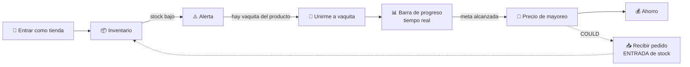

### 2.3 Usuarios

| Perfil | Descripción | Necesidad clave | Implicaciones de diseño |
| :--- | :--- | :--- | :--- |
| **Tendero(a)** (principal) | 35–65 años, usa WhatsApp a diario, poca experiencia con apps de gestión, opera desde su celular entre cliente y cliente. | Saber qué se le acaba y pagar menos por surtir. | Botones grandes, íconos, poco texto, flujos de 1–2 toques, lenguaje coloquial. |
| **Jurado / visitante** (demo) | Evalúa en vivo; puede escanear un QR y entrar como otra tienda. | Entender el valor en segundos. | Entrada sin registro, datos ya cargados. |
| **Equipo (admin demo)** | Opera la demo. | Reiniciar el estado entre ensayos. | Acción "Reiniciar demo". |

### 2.4 Restricciones

| ID | Restricción |
| :--- | :--- |
| **C-01** | Desarrollo en **8 horas continuas**. |
| **C-02** | Stack fijado por el equipo: **Next.js (App Router) + TypeScript + Tailwind CSS + shadcn/ui + PostgreSQL + Prisma**. Autenticación con **Better Auth** opcional (ver §10, ADR-02). |
| **C-03** | Toda funcionalidad presentada debe **demostrarse en vivo** (no cuenta lo que esté solo en diapositivas). |
| **C-04** | Costo de infraestructura ≈ $0 (planes gratuitos de Vercel y Neon/Supabase). |
| **C-05** | Presentación: 5 min exposición + 5 min técnica + 5 min preguntas; pasarse penaliza. |
| **C-06** | Arquitectura **modular por feature** (§4.2) para trabajo en paralelo de 4 personas. |

### 2.5 Suposiciones y dependencias
- **A-01** Habrá internet en la sede (si no: plan B con hotspot y servidor local).
- **A-02** Los precios de menudeo/mayoreo son **simulados pero realistas**.
- **A-03** Todas las tiendas de la demo pertenecen a **una sola colonia**.
- **A-04** El pago y la logística real del pedido grupal ocurren fuera del sistema (ver §9).

---

## 3. Requisitos específicos

> Formato: **ID** · descripción · prioridad · módulo/dueño · criterios de aceptación (Dado / Cuando / Entonces).

### 3.1 Requisitos funcionales

#### 🏪 Módulo `tiendas` — dueño: Sebastían

| ID | Requisito | Prioridad |
| :--- | :--- | :---: |
| **RF-TIE-01** | El sistema debe mostrar en `/` la lista de tiendas de la colonia y permitir **"Entrar como"** una de ellas, guardando la tienda actual en una cookie `tiendaId`. | MUST |
| **RF-TIE-02** | Toda ruta distinta de `/` debe redirigir a `/` si no hay tienda actual válida. | MUST |
| **RF-TIE-03** | El encabezado debe mostrar el nombre de la tienda actual y permitir **cambiar de tienda** en un toque. | MUST |
| **RF-TIE-04** | Una navegación inferior fija debe dar acceso a **Inventario · Vaquitas · Ahorro**, resaltando la sección activa. | MUST |

- **CA RF-TIE-01:** *Dado* que estoy en `/`, *cuando* toco "Abarrotes Doña Lupe", *entonces* llego a `/inventario` y el encabezado dice "Abarrotes Doña Lupe".
- **CA RF-TIE-02:** *Dado* que borré las cookies, *cuando* abro `/vaquitas`, *entonces* soy redirigido a `/`.

#### 📦 Módulo `inventario` — dueño: Alvaro

| ID | Requisito | Prioridad |
| :--- | :--- | :---: |
| **RF-INV-01** | Mostrar el **catálogo de la tienda actual**: nombre, imagen/ícono, unidad, stock actual y semáforo de nivel (RN-01). | MUST |
| **RF-INV-02** | Registrar una **SALIDA** con botón **−** (1 unidad) y con captura de cantidad. | MUST |
| **RF-INV-03** | Registrar una **ENTRADA** con botón **+** (1 unidad) y con captura de cantidad. | MUST |
| **RF-INV-04** | Mostrar **alerta visual** de bajo inventario: el producto en 🔴/🟡 y un contador/banner "Tienes N productos por agotarse". | MUST |
| **RF-INV-05** | Ordenar/filtrar el catálogo para mostrar **primero los productos en rojo**. | SHOULD |
| **RF-INV-06** | Vista de **detalle** del producto con historial de los últimos movimientos. | SHOULD |
| **RF-INV-07** | **Predicción** "se te acaba en ~N días" según RN-07. | SHOULD |
| **RF-INV-08** | **Alerta → Vaquita:** si el producto está bajo y existe una vaquita ABIERTA de ese producto, mostrar *"Faltan X unidades · te ahorras $Y por pieza · [Unirme]"* que lleva a `/vaquitas/[id]`. | SHOULD |
| **RF-INV-09** | Si el producto está bajo y **no** hay vaquita abierta, ofrecer **"Armar una vaquita"**. | COULD |
| **RF-INV-10** | Registrar movimiento escaneando **código de barras** con la cámara. | COULD |

- **CA RF-INV-02:** *Dado* un producto con stock 5, *cuando* toco **−**, *entonces* el stock muestra 4 sin recargar la página y se crea un `Movimiento` SALIDA de 1.
- **CA RF-INV-02 (borde):** *Dado* stock 0, *cuando* intento una SALIDA, *entonces* se rechaza con el mensaje "No hay unidades para sacar" (RN-03).
- **CA RF-INV-04:** *Dado* stockMinimo 6 y stock 7, *cuando* registro 2 salidas, *entonces* el semáforo pasa a 🔴 y el contador de alertas aumenta en 1.
- **CA RF-INV-08:** *Dado* Coca-Cola en 🔴 y una vaquita ABIERTA de Coca-Cola, *cuando* abro el producto, *entonces* veo el aviso con unidades faltantes y ahorro por pieza, y el botón me lleva a esa vaquita.

#### 🐄 Módulo `vaquitas` — dueño: Jesús

| ID | Requisito | Prioridad |
| :--- | :--- | :---: |
| **RF-VAQ-01** | Listar las vaquitas de la colonia con: producto, proveedor, **barra de progreso** (aportado/meta), %, precio menudeo vs mayoreo, tiempo para cierre y estado. | MUST |
| **RF-VAQ-02** | **Aportar** unidades a una vaquita ABIERTA desde la tienda actual ("Entrarle a la vaquita"), respetando RN-04 y RN-05. | MUST |
| **RF-VAQ-03** | Mostrar en el detalle la **lista de aportaciones por tienda** (quién puso cuánto). | MUST |
| **RF-VAQ-04** | Cuando lo aportado alcanza la meta, la vaquita pasa a **COMPLETA** automáticamente (RN-06) y ya no acepta aportaciones. | MUST |
| **RF-VAQ-05** | **Tiempo casi real:** el detalle de la vaquita se actualiza solo (polling cada ≤ 2 s) para que otra pantalla vea subir la barra sin recargar. | MUST |
| **RF-VAQ-06** | **Crear** una vaquita: producto, proveedor, meta de unidades, precio de mayoreo, fecha de cierre. | SHOULD |
| **RF-VAQ-07** | Celebración al completar: **confeti** + "¡Precio de mayoreo desbloqueado!". | SHOULD |
| **RF-VAQ-08** | **Cuenta regresiva** al cierre; al vencer sin completar, la vaquita pasa a CERRADA (RN-08). | SHOULD |
| **RF-VAQ-09** | Botón **"Invitar por WhatsApp"** que abre `https://wa.me/?text=<mensaje + link>`. *(UI: Sebastían)* | SHOULD |
| **RF-VAQ-10** | **QR** del link de la vaquita para que otra persona entre y aporte. *(UI: Sebastían)* | SHOULD |
| **RF-VAQ-11** | **Recibir pedido:** en una vaquita COMPLETA, cada tienda puede marcar "Recibido" y se genera una ENTRADA en su inventario por la cantidad aportada. | COULD |
| **RF-VAQ-12** | Mostrar el **punto de entrega** (tienda que recibe el pedido). | COULD |

- **CA RF-VAQ-02:** *Dado* una vaquita con meta 100 y 70 aportadas, *cuando* "El Güero" aporta 20, *entonces* la barra muestra 90/100 (90 %) y su aportación aparece en la lista.
- **CA RF-VAQ-02 (borde):** *Dado* que faltan 10, *cuando* intento aportar 15, *entonces* se rechaza con "Solo faltan 10 unidades" (RN-05).
- **CA RF-VAQ-04:** *Dado* que faltan 10, *cuando* aporto 10, *entonces* el estado es COMPLETA, se oculta el botón de aportar y se muestra el precio de mayoreo como aplicado.
- **CA RF-VAQ-05:** *Dado* la misma vaquita abierta en dos dispositivos, *cuando* aporto en el dispositivo A, *entonces* el dispositivo B refleja el cambio en ≤ 3 s sin recargar.

#### 💰 Módulo `ahorro` — dueño: Sebastían

| ID | Requisito | Prioridad |
| :--- | :--- | :---: |
| **RF-AHO-01** | Mostrar el **ahorro de la tienda actual**: suma de RN-09 sobre sus aportaciones en vaquitas COMPLETAS, en pesos MXN. | MUST |
| **RF-AHO-02** | Desglose por vaquita: producto, unidades, precio menudeo vs mayoreo, ahorro. | SHOULD |
| **RF-AHO-03** | **Ahorro de la colonia** (todas las tiendas) y "ahorro potencial" de vaquitas ABIERTAS. | COULD |

- **CA RF-AHO-01:** *Dado* que Doña Lupe aportó 30 Cocas a una vaquita COMPLETA con menudeo $18.00 y mayoreo $14.50, *entonces* su ahorro muestra **$105.00**.

#### 🎬 Demo y datos — dueño: Hiram

| ID | Requisito | Prioridad |
| :--- | :--- | :---: |
| **RF-DEM-01** | Un **seed** carga: 1 colonia de Morelia, **3 tiendas**, ~10 productos, inventario por tienda con 2–3 productos en 🔴, movimientos de los últimos 7 días, **1 vaquita ABIERTA al ~70 %** con aportaciones de 2 tiendas y **1 vaquita COMPLETA**. | MUST |
| **RF-DEM-02** | Acción **"Reiniciar demo"** que borra y vuelve a cargar el seed. | SHOULD |
| **RF-DEM-03** | Inicio de sesión con **Better Auth** (correo/contraseña precargados por tienda) en lugar del selector. | COULD |

### 3.2 Requisitos no funcionales

| ID | Categoría | Requisito | Medición |
| :--- | :--- | :--- | :--- |
| **RNF-01** | Usabilidad | Un tendero registra una venta en **≤ 2 toques** desde `/inventario`. | Prueba manual |
| **RNF-02** | Usabilidad | Objetivos táctiles de **≥ 44×44 px**; texto base **≥ 16 px**; cantidades de stock **≥ 24 px**. | Inspección |
| **RNF-03** | Usabilidad | El estado de stock se comunica con **color + ícono/texto** (no solo color). | Inspección |
| **RNF-04** | Usabilidad | Lenguaje coloquial mexicano y sin tecnicismos ("Surtir", "Me quedan", "Entrarle a la vaquita"). | Revisión de textos |
| **RNF-05** | Compatibilidad | **Mobile-first**: funcional en 360 px de ancho sin scroll horizontal; también en laptop. Chrome/Safari móviles actuales. | Prueba en celular |
| **RNF-06** | Rendimiento | Las acciones (+/−, aportar) se reflejan en UI en **≤ 1 s** (actualización optimista o revalidación). | Prueba manual |
| **RNF-07** | Tiempo real | Propagación entre dispositivos **≤ 3 s** (polling ≤ 2 s). | CA RF-VAQ-05 |
| **RNF-08** | Disponibilidad | La demo corre en una **URL pública** (Vercel) estable durante la presentación. | Deploy verificado |
| **RNF-09** | Integridad | Las reglas RN-03 a RN-06 se validan **en el servidor** (no solo en la UI). Las aportaciones se escriben en **transacción**. | Revisión de código |
| **RNF-10** | Mantenibilidad | Arquitectura modular por feature (§4.2); un módulo solo importa a otro vía su `index.ts`. | Revisión de imports |
| **RNF-11** | Mantenibilidad | TypeScript estricto; sin `any` en contratos de módulo. | `tsc --noEmit` |
| **RNF-12** | Seguridad | Secretos solo en variables de entorno (`.env` fuera del repo). Entradas validadas (enteros ≥ 1). | Revisión |
| **RNF-13** | Localización | Moneda en **MXN** con formato `$1,234.50`; fechas en español (`es-MX`). | Inspección |
| **RNF-14** | Resiliencia demo | Errores mostrados como mensajes amigables (toast), nunca pantalla en blanco. | Prueba manual |

### 3.3 Reglas de negocio

| ID | Regla |
| :--- | :--- |
| **RN-01** | **Semáforo de stock:** 🔴 `stock ≤ stockMinimo` · 🟡 `stockMinimo < stock ≤ 2 × stockMinimo` · 🟢 `stock > 2 × stockMinimo`. "Bajo stock" = 🔴. |
| **RN-02** | La cantidad de cualquier movimiento o aportación es un **entero ≥ 1**. |
| **RN-03** | Una SALIDA no puede dejar el stock **negativo**. |
| **RN-04** | Solo se puede aportar a vaquitas en estado **ABIERTA** y con `cierraEn` en el futuro. |
| **RN-05** | Una aportación **no puede exceder** las unidades faltantes (`meta − totalAportado`). |
| **RN-06** | Si `totalAportado == metaUnidades`, la vaquita pasa a **COMPLETA** en la misma transacción de la aportación. |
| **RN-07** | **Predicción:** `diasParaAgotarse = floor(stock / promedioSalidasDiarias)` usando las SALIDAS de los últimos 7 días. Si el promedio es 0 → "Sin datos suficientes". |
| **RN-08** | Una vaquita ABIERTA con `cierraEn` vencido y meta no alcanzada se considera **CERRADA** (se evalúa al consultarla; no se requiere cron). |
| **RN-09** | **Ahorro** de una aportación = `(precioMenudeo − precioMayoreo) × cantidad`. Solo cuenta como "ahorrado" si la vaquita está **COMPLETA**; si está ABIERTA es "ahorro potencial". |
| **RN-10** | Una tienda puede aportar **varias veces** a la misma vaquita; en la lista se muestran sumadas por tienda. |
| **RN-11** | `precioMayoreo` debe ser **menor** que `precioMenudeo` del producto al crear una vaquita. |
| **RN-12** | Solo puede haber **una vaquita ABIERTA por producto** a la vez en la colonia (simplifica RF-INV-08). |

---

## 4. Arquitectura y diagramas de componentes

### 4.1 Vista de contexto

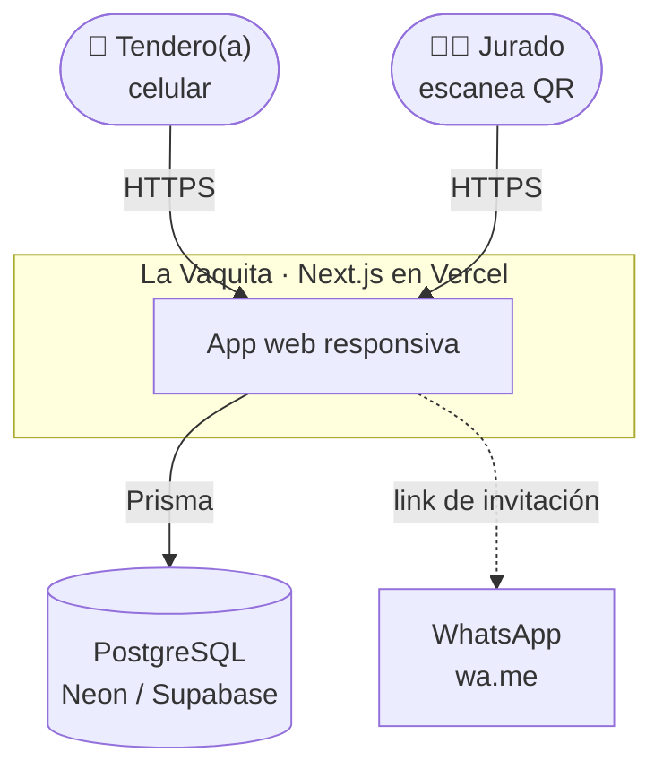

### 4.2 Diagrama de componentes (módulos)

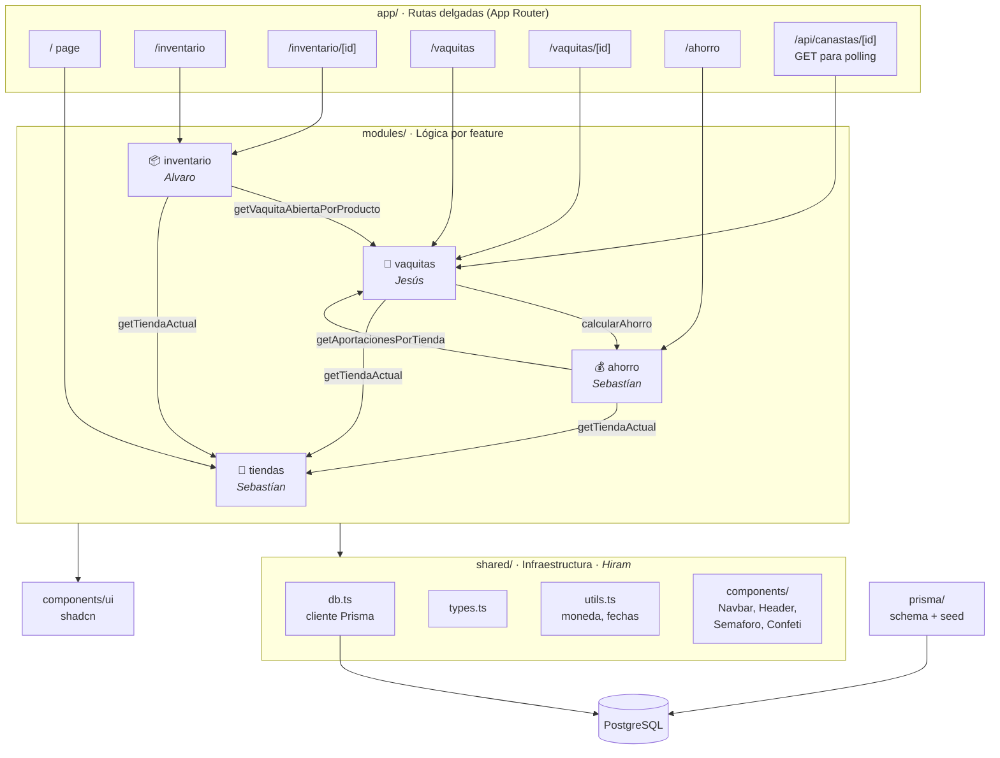

**Reglas de dependencia**
- `app/` → `modules/` → `shared/` → BD. Nunca al revés.
- Entre módulos: **solo** a través de `index.ts` y solo las funciones listadas en §6.
- `ahorro ↔ vaquitas` es la única dependencia mutua permitida: `ahorro` lee aportaciones; `vaquitas` usa la función pura `calcularAhorro`. Para evitar ciclos de import, `calcularAhorro` vive en `modules/ahorro/logic.ts` (sin dependencias).

### 4.3 Estructura interna de un módulo

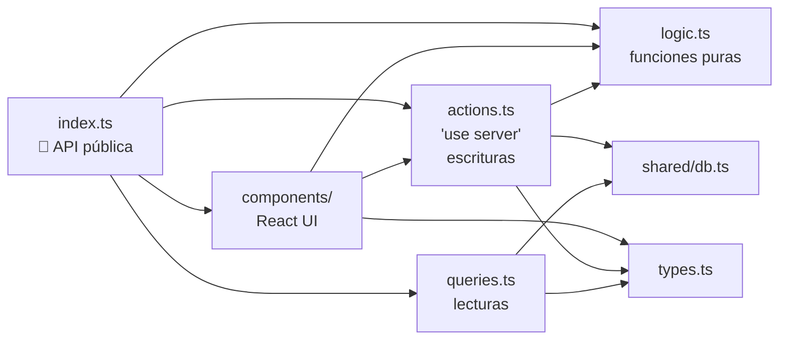

```
modules/<módulo>/
├── components/    # UI del módulo
├── actions.ts     # server actions (mutaciones + validación de RN)
├── queries.ts     # lecturas Prisma (server)
├── logic.ts       # funciones puras, sin BD ni React (fáciles de probar y explicar)
├── types.ts       # tipos del módulo
└── index.ts       # re-exporta lo público
```

### 4.4 Árbol de carpetas completo

```
src/
├── app/
│   ├── layout.tsx                    # Sebastían
│   ├── page.tsx                      # → tiendas
│   ├── inventario/page.tsx           # → inventario
│   ├── inventario/[id]/page.tsx      # → inventario
│   ├── vaquitas/page.tsx             # → vaquitas
│   ├── vaquitas/[id]/page.tsx        # → vaquitas
│   ├── ahorro/page.tsx               # → ahorro
│   └── api/canastas/[id]/route.ts    # → vaquitas
├── modules/
│   ├── tiendas/
│   ├── inventario/
│   ├── vaquitas/
│   └── ahorro/
├── shared/
│   ├── db.ts
│   ├── types.ts
│   ├── utils.ts
│   ├── demo.ts                       # reiniciarDemo() [RF-DEM-02]
│   └── components/
├── components/ui/                    # shadcn (generado)
└── middleware.ts                     # redirección sin tienda [RF-TIE-02]
prisma/
├── schema.prisma
└── seed.ts
```

### 4.5 Diagrama de despliegue

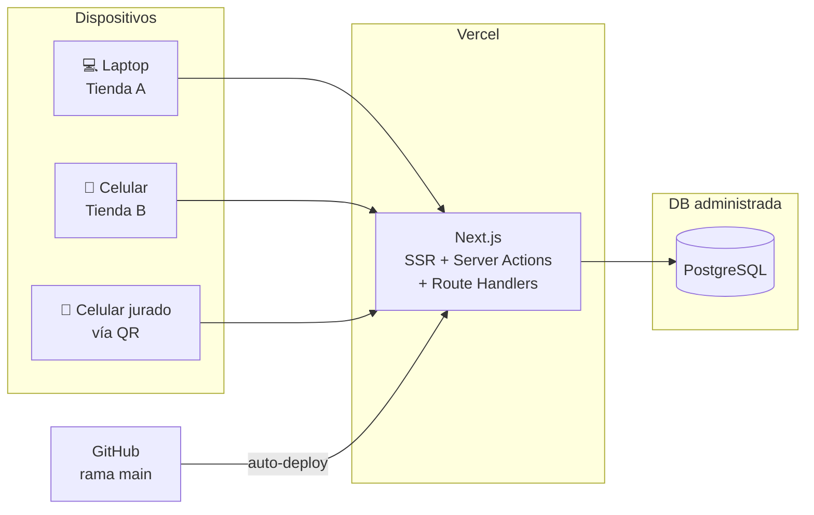

---

## 5. Modelo de datos

### 5.1 Diagrama entidad-relación

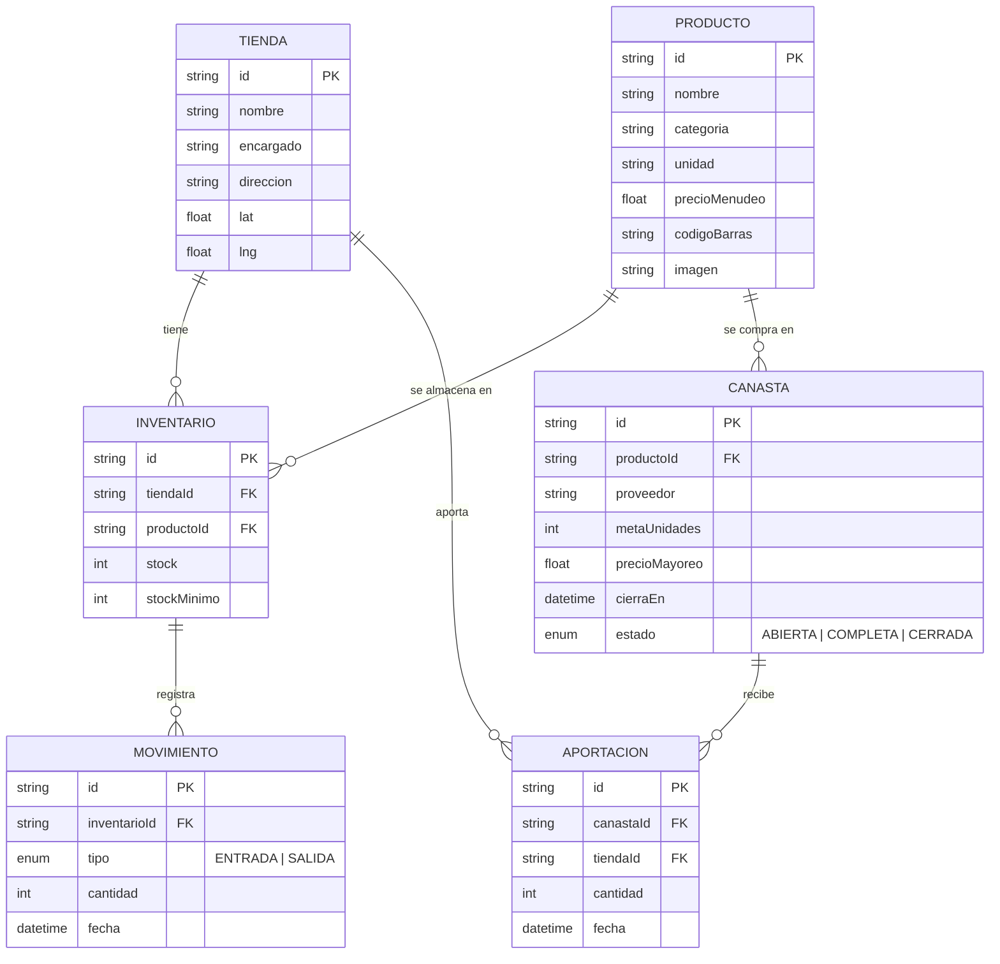

### 5.2 Diagrama de estados — Vaquita (`Canasta`)

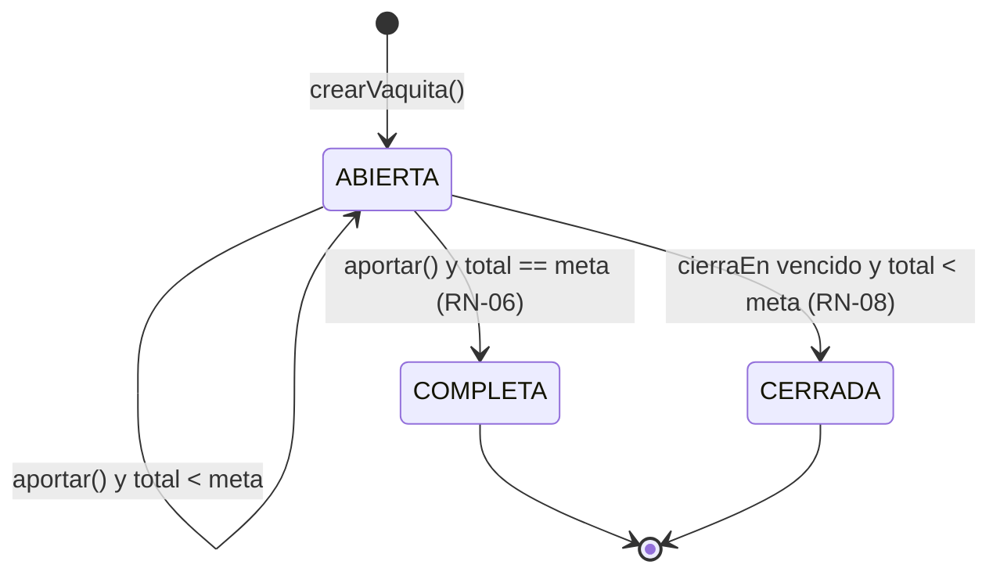

### 5.3 Esquema Prisma (contrato)

```prisma
generator client {
  provider = "prisma-client-js"
}

datasource db {
  provider = "postgresql"
  url      = env("DATABASE_URL")
}

model Tienda {
  id           String       @id @default(cuid())
  nombre       String
  encargado    String
  direccion    String
  lat          Float?
  lng          Float?
  inventario   Inventario[]
  aportaciones Aportacion[]
}

model Producto {
  id            String       @id @default(cuid())
  nombre        String
  categoria     String
  unidad        String
  precioMenudeo Float
  codigoBarras  String?      @unique
  imagen        String?
  inventarios   Inventario[]
  canastas      Canasta[]
}

model Inventario {
  id          String       @id @default(cuid())
  tiendaId    String
  productoId  String
  stock       Int
  stockMinimo Int
  tienda      Tienda       @relation(fields: [tiendaId], references: [id], onDelete: Cascade)
  producto    Producto     @relation(fields: [productoId], references: [id], onDelete: Cascade)
  movimientos Movimiento[]

  @@unique([tiendaId, productoId])
}

model Movimiento {
  id           String     @id @default(cuid())
  inventarioId String
  tipo         TipoMov
  cantidad     Int
  fecha        DateTime   @default(now())
  inventario   Inventario @relation(fields: [inventarioId], references: [id], onDelete: Cascade)

  @@index([inventarioId, fecha])
}

model Canasta {
  id            String        @id @default(cuid())
  productoId    String
  proveedor     String
  metaUnidades  Int
  precioMayoreo Float
  cierraEn      DateTime
  estado        EstadoCanasta @default(ABIERTA)
  creadaEn      DateTime      @default(now())
  producto      Producto      @relation(fields: [productoId], references: [id], onDelete: Cascade)
  aportaciones  Aportacion[]

  @@index([productoId, estado])
}

model Aportacion {
  id        String   @id @default(cuid())
  canastaId String
  tiendaId  String
  cantidad  Int
  fecha     DateTime @default(now())
  canasta   Canasta  @relation(fields: [canastaId], references: [id], onDelete: Cascade)
  tienda    Tienda   @relation(fields: [tiendaId], references: [id], onDelete: Cascade)
}

enum TipoMov {
  ENTRADA
  SALIDA
}

enum EstadoCanasta {
  ABIERTA
  COMPLETA
  CERRADA
}
```

> Nota: se usa `Float` para precios por simplicidad del hackathon. En producción se usaría `Decimal`.

### 5.4 Datos semilla (RF-DEM-01)

| Elemento | Valor |
| :--- | :--- |
| Colonia | Una colonia real de Morelia (ej. *Chapultepec Norte*) |
| Tiendas | **Abarrotes Doña Lupe** · **Miscelánea El Güero** · **Tienda La Esperanza** (coordenadas cercanas entre sí) |
| Productos (~10) | Coca-Cola 600 ml, Sabritas 45 g, Pan Bimbo, Huevo (kg), Aceite 1 L, Frijol 1 kg, Arroz 1 kg, Maseca 1 kg, Leche 1 L, Papel higiénico 4 pzas |
| Inventario | Cada tienda con los 10 productos; **2–3 en 🔴** por tienda (incluyendo Coca-Cola en Doña Lupe) |
| Movimientos | SALIDAS diarias de los últimos 7 días (para RN-07) |
| Vaquita ABIERTA | Coca-Cola · Central de Abastos Morelia · meta **100** · aportado **70** (Güero 40 + Esperanza 30) · cierra en 2 días |
| Vaquita COMPLETA | Maseca · meta 50 · Doña Lupe 20 + Güero 15 + Esperanza 15 |

---

## 6. Interfaces y contratos

### 6.1 Rutas de UI

| Ruta | Requisitos | Módulo |
| :--- | :--- | :--- |
| `/` | RF-TIE-01 | tiendas |
| `/inventario` | RF-INV-01…05 | inventario |
| `/inventario/[id]` *(id = Inventario.id)* | RF-INV-06…09 | inventario |
| `/vaquitas` | RF-VAQ-01, RF-VAQ-06 | vaquitas |
| `/vaquitas/[id]` | RF-VAQ-02…05, 07…12 | vaquitas |
| `/ahorro` | RF-AHO-01…03 | ahorro |

### 6.2 API HTTP

**`GET /api/canastas/[id]`** — usada por el polling (RF-VAQ-05).

```jsonc
// 200 OK
{
  "id": "ck…",
  "producto": { "id": "ck…", "nombre": "Coca-Cola 600 ml", "precioMenudeo": 18.0 },
  "proveedor": "Central de Abastos Morelia",
  "metaUnidades": 100,
  "totalAportado": 90,
  "faltan": 10,
  "porcentaje": 90,
  "precioMayoreo": 14.5,
  "estado": "ABIERTA",          // ya evaluado con RN-08
  "cierraEn": "2026-11-21T23:59:00.000Z",
  "aportaciones": [
    { "tiendaId": "ck…", "tienda": "Miscelánea El Güero", "cantidad": 60 },
    { "tiendaId": "ck…", "tienda": "Tienda La Esperanza", "cantidad": 30 }
  ]
}
// 404 { "error": "Vaquita no encontrada" }
```

### 6.3 Contratos de módulo (`index.ts`)

Tipo de retorno estándar para acciones:

```ts
// shared/types.ts
export type Resultado<T = void> =
  | { ok: true; data: T }
  | { ok: false; error: string }; // mensaje listo para mostrar al usuario
```

#### `@/modules/tiendas`
```ts
export function listarTiendas(): Promise<TiendaDTO[]>;
export function getTiendaActual(): Promise<TiendaDTO | null>;          // lee cookie tiendaId
export function entrarComoTienda(tiendaId: string): Promise<Resultado>; // server action, escribe cookie
export { SelectorTienda, HeaderTienda } from "./components";
```

#### `@/modules/inventario`
```ts
export type NivelStock = "ok" | "bajo" | "critico"; // 🟢 | 🟡 | 🔴

export function getInventarioPorTienda(tiendaId: string): Promise<ItemInventarioDTO[]>;
export function getDetalleInventario(inventarioId: string): Promise<DetalleInventarioDTO | null>;
export function getProductosBajoStock(tiendaId: string): Promise<ItemInventarioDTO[]>;
export function registrarMovimiento(input: {
  inventarioId: string;
  tipo: "ENTRADA" | "SALIDA";
  cantidad: number;
}): Promise<Resultado<{ stock: number }>>;                     // valida RN-02, RN-03

// logic.ts (puras)
export function nivelStock(stock: number, stockMinimo: number): NivelStock;          // RN-01
export function diasParaAgotarse(stock: number, salidasUltimos7Dias: number): number | null; // RN-07
```

#### `@/modules/vaquitas`
```ts
export function listarVaquitas(filtro?: { estado?: EstadoCanasta }): Promise<VaquitaDTO[]>;
export function getVaquita(canastaId: string): Promise<VaquitaDetalleDTO | null>; // mismo shape que §6.2
export function getVaquitaAbiertaPorProducto(productoId: string): Promise<VaquitaDTO | null>; // RN-12
export function getAportacionesPorTienda(tiendaId: string): Promise<AportacionDTO[]>;
export function aportarAVaquita(input: {
  canastaId: string;
  tiendaId: string;
  cantidad: number;
}): Promise<Resultado<{ totalAportado: number; estado: EstadoCanasta }>>; // RN-02, 04, 05, 06 en transacción
export function crearVaquita(input: {
  productoId: string;
  proveedor: string;
  metaUnidades: number;
  precioMayoreo: number;
  cierraEn: Date;
}): Promise<Resultado<{ id: string }>>;                                    // RN-11, RN-12

// logic.ts (puras)
export function estadoEfectivo(estado: EstadoCanasta, cierraEn: Date, total: number, meta: number): EstadoCanasta; // RN-06, RN-08
export function porcentaje(total: number, meta: number): number;
```

#### `@/modules/ahorro`
```ts
export function calcularAhorro(precioMenudeo: number, precioMayoreo: number, cantidad: number): number; // RN-09 (pura)
export function getResumenAhorroTienda(tiendaId: string): Promise<{
  ahorrado: number;
  potencial: number;
  detalle: Array<{ vaquitaId: string; producto: string; cantidad: number; ahorro: number; estado: EstadoCanasta }>;
}>;
export function getResumenAhorroColonia(): Promise<{ ahorrado: number; potencial: number }>;
```

#### `@/shared`
```ts
export const db: PrismaClient;
export function formatoMoneda(n: number): string;      // "$1,234.50" es-MX
export function reiniciarDemo(): Promise<Resultado>;   // RF-DEM-02
```

> 💡 **Para no bloquearse:** cada dueño publica primero estas firmas en su `index.ts` devolviendo datos mock y después conecta Prisma. Las firmas **no cambian** al conectarlas.

---

## 7. Casos de uso y flujos

### 7.1 Diagrama de casos de uso

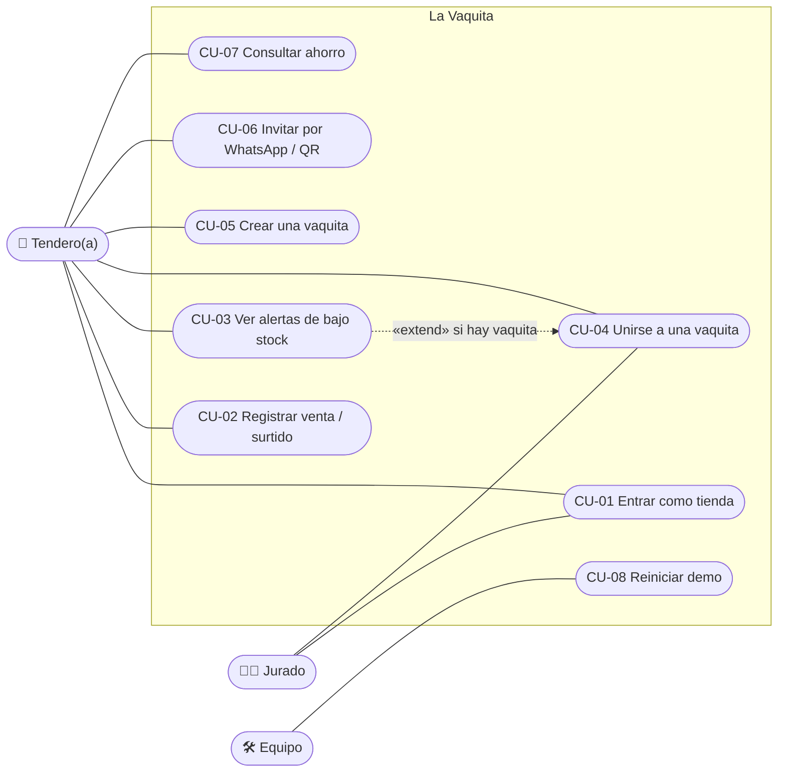

### 7.2 Especificación de casos de uso principales

**CU-02 · Registrar venta/surtido** (RF-INV-02, 03, 04)
| | |
| :--- | :--- |
| Actor | Tendero(a) |
| Precondición | Tienda actual seleccionada |
| Flujo principal | 1. Abre `/inventario`. 2. Toca **−** en un producto. 3. El sistema valida RN-02/RN-03, crea el movimiento y actualiza el stock. 4. Si el nivel cambia a 🔴 se actualiza el semáforo y el contador de alertas. |
| Flujo alterno | 2a. Toca la cantidad y escribe N. 3a. Stock insuficiente → toast "No hay unidades para sacar". |
| Postcondición | `Inventario.stock` actualizado y `Movimiento` creado. |

**CU-04 · Unirse a una vaquita** (RF-VAQ-02, 04, 05, 07)
| | |
| :--- | :--- |
| Actor | Tendero(a), Jurado |
| Precondición | Tienda actual; vaquita ABIERTA vigente |
| Flujo principal | 1. Abre `/vaquitas/[id]` (desde lista, alerta o QR). 2. Elige cantidad (por defecto lo que falta o 10). 3. Toca **"Entrarle a la vaquita"**. 4. El servidor valida RN-02/04/05 y guarda en transacción. 5. Si se llega a la meta → COMPLETA + confeti. 6. Otras pantallas lo ven por polling. |
| Flujo alterno | 4a. Excede lo faltante → "Solo faltan X unidades". 4b. Vaquita ya COMPLETA/CERRADA → "Esta vaquita ya cerró". |
| Postcondición | `Aportacion` creada; estado posiblemente COMPLETA. |

### 7.3 Secuencia — Registrar salida y alerta → vaquita

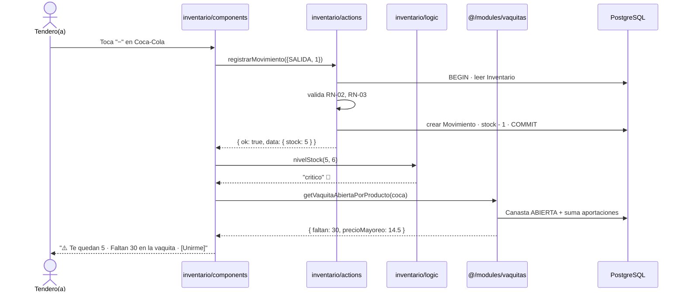

### 7.4 Secuencia — Aportar y propagación en tiempo real

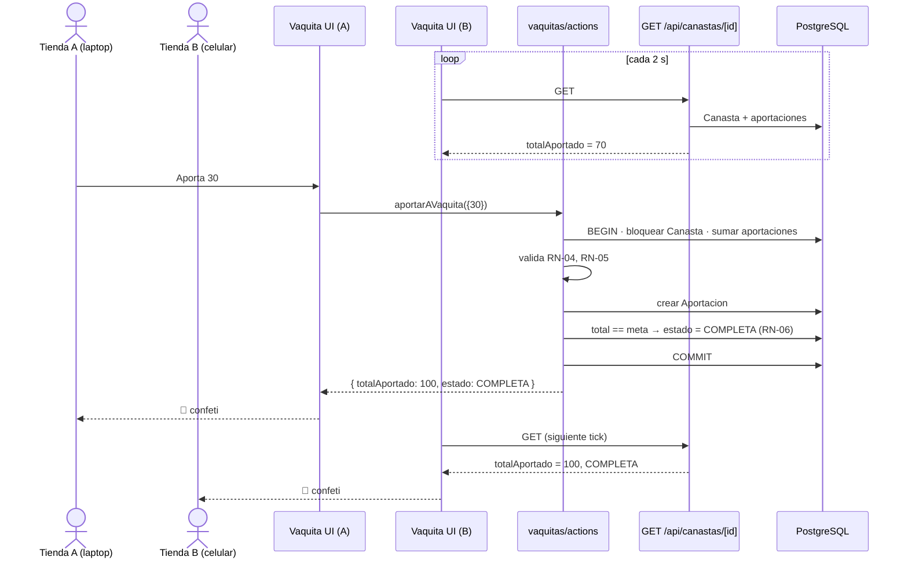

### 7.5 Mapa de navegación

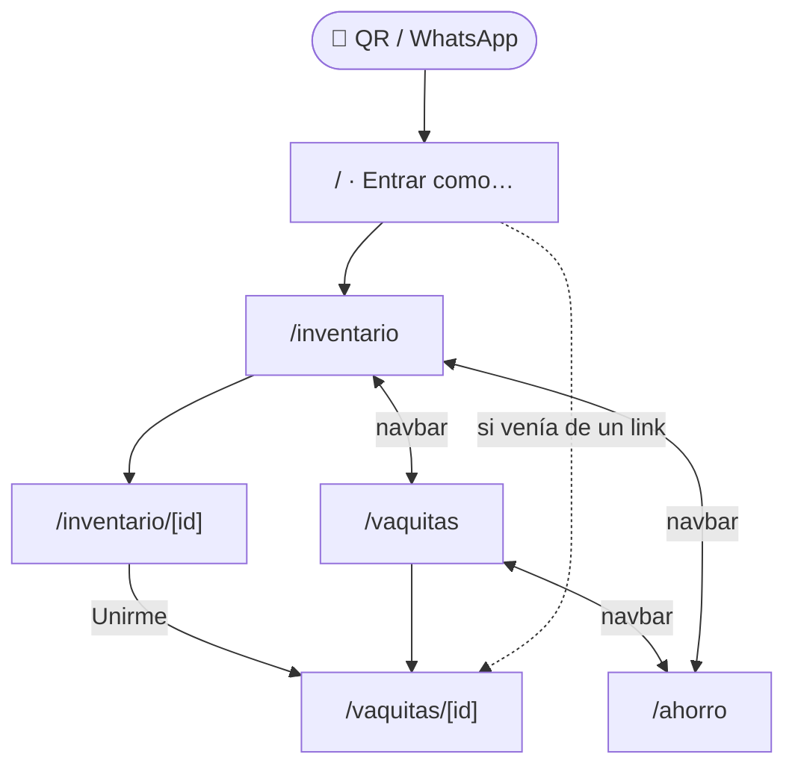

---

## 8. Plan de verificación (pruebas manuales de demo)

> Se ejecuta completo en el **deploy** en los checkpoints 2 (4:00) y final (7:00).

| ID | Prueba | Requisitos | Resultado esperado |
| :--- | :--- | :--- | :--- |
| **PR-01** | Entrar como cada una de las 3 tiendas | RF-TIE-01, 03, RF-DEM-01 | Cada tienda ve su propio inventario |
| **PR-02** | Abrir `/inventario` sin cookie | RF-TIE-02 | Redirige a `/` |
| **PR-03** | Vender hasta que un producto pase a 🔴 | RF-INV-02, 04, RN-01 | Semáforo y contador cambian |
| **PR-04** | Intentar vender con stock 0 | RN-03 | Mensaje de error, stock sigue en 0 |
| **PR-05** | Surtir 10 unidades | RF-INV-03 | Stock +10, semáforo se actualiza |
| **PR-06** | Producto en 🔴 con vaquita abierta | RF-INV-08 | Aparece aviso y lleva a la vaquita |
| **PR-07** | Aportar desde 2 dispositivos a la misma vaquita | RF-VAQ-02, 03, 05, RNF-07 | Ambos ven el progreso en ≤ 3 s |
| **PR-08** | Aportar más de lo que falta | RN-05 | Rechazo "Solo faltan X" |
| **PR-09** | Completar la vaquita | RF-VAQ-04, 07, RN-06 | Estado COMPLETA, confeti, sin botón de aportar |
| **PR-10** | Ver ahorro tras completar | RF-AHO-01, RN-09 | Ahorro correcto en MXN |
| **PR-11** | Escanear QR con otro celular y aportar | RF-VAQ-10 | Entra, elige tienda y aporta |
| **PR-12** | Invitar por WhatsApp | RF-VAQ-09 | Abre WhatsApp con mensaje y link |
| **PR-13** | Reiniciar demo | RF-DEM-02 | Vuelve al estado del seed |
| **PR-14** | Todo el flujo en celular de 360 px | RNF-02, 05 | Sin scroll horizontal, botones cómodos |

Las funciones puras de `logic.ts` (`nivelStock`, `diasParaAgotarse`, `estadoEfectivo`, `porcentaje`, `calcularAhorro`) son candidatas a pruebas unitarias rápidas si sobra tiempo.

---

## 9. Fuera de alcance (WON'T)

- Pagos en línea, cobros o divisiones de pago reales.
- Logística/entrega real con proveedores; integración con APIs de distribuidores.
- Fiado / crédito a clientes, punto de venta completo, facturación (CFDI).
- Múltiples colonias, administración de usuarios, roles y permisos.
- Notificaciones push o SMS reales.
- App nativa (se ofrece web responsiva; PWA es opcional).

---

## 10. Decisiones de arquitectura (ADR)

| ID | Decisión | Motivo | Alternativa descartada |
| :--- | :--- | :--- | :--- |
| **ADR-01** | Arquitectura **modular por feature** con API pública en `index.ts` | 4 personas en paralelo sin conflictos de merge; cada dueño explica su módulo en la demo técnica | Carpetas por tipo (`components/`, `lib/`) que mezclan dueños |
| **ADR-02** | Identificación por **selector de tienda + cookie** (MUST); Better Auth como COULD | Login no suma puntos en la rúbrica y consume 1–2 h; la demo con QR necesita entrada inmediata | Better Auth obligatorio desde el inicio |
| **ADR-03** | **Polling cada 2 s** para tiempo real | Funciona con Postgres + Prisma sin infraestructura extra; suficiente para 3–5 clientes | WebSockets / Supabase Realtime (más setup) |
| **ADR-04** | **Server Actions** para mutaciones y un Route Handler solo para el polling | Menos código y tipado de punta a punta | API REST completa |
| **ADR-05** | Catálogo de **Producto global** + `Inventario` por tienda | Permite enlazar la alerta de un producto con la vaquita del mismo producto (RF-INV-08) | Productos duplicados por tienda |
| **ADR-06** | Validación de reglas **en servidor y en transacción** | Dos tiendas aportando al mismo tiempo no deben pasarse de la meta | Validar solo en la UI |

---

## 11. Matriz de trazabilidad

| Requisito | Reto | Módulo | Dueño | Prioridad | Prueba | Rúbrica |
| :--- | :---: | :--- | :--- | :---: | :--- | :--- |
| RF-TIE-01…04 | R3 | tiendas | Sebastían | MUST | PR-01, 02 | Navegación, Flujo principal |
| RF-INV-01…04 | R1 | inventario | Alvaro | MUST | PR-03, 04, 05 | Funcionalidades esenciales |
| RF-INV-05…07 | R1 | inventario | Alvaro | SHOULD | PR-03 | Lógica y manejo de datos |
| RF-INV-08 | R1+R2 | inventario | Alvaro | SHOULD | PR-06 | Flujo principal, Integración |
| RF-VAQ-01…05 | R2 | vaquitas | Jesús | MUST | PR-07, 08, 09 | Flujo principal, Integración y respuesta |
| RF-VAQ-06…08 | R2 | vaquitas | Jesús | SHOULD | PR-09 | Funcionalidades esenciales |
| RF-VAQ-09, 10 | R2 | vaquitas (UI) | Sebastían | SHOULD | PR-11, 12 | Pertinencia en México |
| RF-AHO-01…03 | — | ahorro | Sebastían | MUST/SHOULD | PR-10 | Beneficio al usuario |
| RF-DEM-01, 02 | R3 | shared/prisma | Hiram | MUST/SHOULD | PR-01, 13 | Ejecución y estabilidad |
| RNF-01…05 | — | todos | Sebastían (revisa) | MUST | PR-14 | UX/UI (15 pts) |
| RNF-06…09 | — | todos | Hiram (revisa) | MUST | PR-07 | Ejecución y estabilidad |

---

## 12. Historial de cambios

| Versión | Fecha | Autor | Cambio |
| :--- | :--- | :--- | :--- |
| 1.0 | 2026-11-19 | Equipo REYES | Versión inicial |
