# 📘 SRS — La Vaquita

**Especificación de Requisitos de Software** · basada en IEEE 830 / ISO/IEC/IEEE 29148 (versión ligera para hackathon)

| Campo | Valor |
| :--- | :--- |
| Proyecto | **La Vaquita** — Inventario rápido y compras colectivas para tienditas |
| Evento | HackaPony 2026 · Reto 01: Comercio Local y PyMEs · Instituto Tecnológico de Morelia |
| Equipo | REYES (Reyes 3): Hiram, Alvaro, Jesús, Sebastían |
| Versión | 1.1 |
| Fecha | 2026-11-19 |
| Documentos relacionados | [`plan.md`](plan.md) (reto, rúbrica, roles, cronograma y visión a producción) · `README.md` |

---

## 🤖 0. Guía para agentes y desarrolladores

Este documento es la **fuente de verdad** de qué se construye. Si vas a escribir código (persona o agente de IA):

1. **Ubica tu requisito por ID** (`RF-INV-03`, `RN-02`, etc.) y cítalo en tu commit/PR: `feat(inventario): alerta bajo stock [RF-INV-04]`.
2. **Respeta los contratos de módulo** de la §6. No cambies firmas ni el modelo de datos (§5.3) sin avisar al equipo; si lo cambias, **actualiza este documento en el mismo PR**.
3. **Trabaja solo dentro del módulo asignado** (§4.2). Entre módulos se importa únicamente desde `@/modules/<módulo>` (su `index.ts`).
4. **Las reglas de negocio (§3.3) mandan.** Si la UI y una regla chocan, gana la regla.
5. **Prioridad MoSCoW:** haz todos los `MUST` antes de tocar un `SHOULD`; los `COULD` solo después del *feature freeze* si hay tiempo… y no, después del freeze no hay tiempo.
6. **Criterio de terminado:** un requisito está hecho cuando pasan sus criterios de aceptación (§3 y §8) **en la laptop de demo** con el seed limpio, no solo en tu máquina.
7. Lo marcado como **Fuera de alcance (§9)** no se implementa aunque parezca fácil.

---

## 1. Introducción

### 1.1 Propósito
Definir los requisitos funcionales, no funcionales, reglas de negocio, arquitectura de componentes e interfaces del prototipo **La Vaquita**, para que los 4 integrantes y sus agentes de IA desarrollen en paralelo y de forma modular, sin ambigüedad, dentro de las 8 horas del hackathon.

### 1.2 Problema
Las tienditas de abarrotes de colonia en México compran insumos **al menudeo** y pierden margen frente a cadenas (OXXO, supermercados) que compran por volumen. Además, no tienen un control ágil de qué productos están por agotarse, lo que provoca quiebres de stock y compras de emergencia caras.

### 1.3 Alcance
La Vaquita es una **aplicación web responsiva (mobile-first)** donde comerciantes de una misma colonia:

- registran su **inventario básico** (entradas/salidas) y reciben **alertas visuales** de bajo stock;
- crean o se unen a **"vaquitas"** (canastas de compra colectiva) para sumar unidades de un producto hasta alcanzar la **meta de mayoreo** y obtener el precio de volumen;
- ven **cuánto ahorran** al comprar en grupo;
- se registran con un **login seguro** (OWASP + ISO/IEC 27001) y **comprueban que su tienda existe** (foto de fachada, ubicación, comprobante de domicilio e INE). Un **administrador** aprueba la tienda antes de que pueda usar el sistema.

El nombre viene de la expresión mexicana *"hacer la vaquita"*: juntarse entre varios para pagar algo.

### 1.4 Definiciones y acrónimos

| Término | Definición |
| :--- | :--- |
| **Tienda** | Comercio de colonia que usa el sistema (abarrotes, miscelánea). |
| **Tendero(a)** | Persona que opera la tienda; usuario principal. |
| **Producto** | Artículo del catálogo global (ej. "Coca-Cola 600 ml"). Es el mismo para todas las tiendas. |
| **Inventario** | Stock de un producto en una tienda concreta. |
| **Movimiento** | Registro de ENTRADA (surtir) o SALIDA (venta/merma) de unidades. |
| **Stock mínimo** | Umbral por debajo del cual el producto se considera bajo. |
| **Vaquita / Canasta** | Pedido grupal de un producto con una meta de unidades y un precio de mayoreo. En código: `Canasta`. |
| **Aportación** | Unidades que una tienda compromete a una vaquita. |
| **Meta de mayoreo** | Unidades totales necesarias para obtener el precio de mayoreo. |
| **Tienda actual** | Tienda del usuario con sesión iniciada (relación `User` → `Tienda`). |
| **Admin** | Usuario con rol `ADMIN` que revisa y aprueba o rechaza tiendas. |
| **Verificación de tienda** | Revisión manual de la fachada, la ubicación, el comprobante de domicilio y la INE antes de dar acceso. Estados: PENDIENTE, APROBADA, RECHAZADA, SUSPENDIDA. |
| **Guard** | Función de servidor que revisa sesión, rol o estatus antes de ejecutar una acción (`requireSession`, `requireAdmin`, `requireTiendaAprobada`). |
| **Mailpit** | Buzón de correo local para desarrollo y demo (`localhost:8025`). |
| **MVP** | Producto Mínimo Viable exigido por el reto. |
| **MoSCoW** | Prioridad: MUST (obligatorio), SHOULD (importante), COULD (deseable), WON'T (no se hará). |

### 1.5 Requisitos del reto (origen)
De la ficha técnica del reto (sección *Ficha técnica del reto* en [`plan.md`](plan.md)), el MVP **obligatorio** es:

| ID reto | Requisito oficial | Cubierto por |
| :--- | :--- | :--- |
| **R1** | Catálogo simple con control de stock (entradas/salidas y alerta visual de bajo inventario) | RF-INV-01 … RF-INV-05 |
| **R2** | Módulo de "Pedido Grupal" donde 2 o más tiendas suman unidades hasta completar la meta de mayoreo | RF-VAQ-01 … RF-VAQ-06 |
| **R3** | Demo funcional con datos simulados de al menos 3 tiendas de una colonia | RF-DEM-01, RF-DEM-02 |
| **Equipo** | Login seguro y verificación de tiendas (decisión del equipo) | RF-AUT-01 … RF-AUT-08, RF-VER-01 … RF-VER-08, RNF-SEC-01 … RNF-SEC-14 |

---

## 2. Descripción general

### 2.1 Perspectiva del producto
Sistema nuevo e independiente. Para la demo corre **en local** en una laptop (Next.js + PostgreSQL y Mailpit en Docker) y los celulares entran por la red local; Vercel es un respaldo opcional. No se integra con sistemas externos en el MVP, salvo enlaces de WhatsApp (`wa.me`), generación de QR del lado del cliente y mosaicos de mapa de OpenStreetMap.

### 2.2 Funciones principales

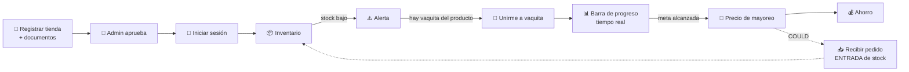

### 2.3 Usuarios

| Perfil | Descripción | Necesidad clave | Implicaciones de diseño |
| :--- | :--- | :--- | :--- |
| **Tendero(a)** (principal) | 35–65 años, usa WhatsApp a diario, poca experiencia con apps de gestión, opera desde su celular entre cliente y cliente. | Saber qué se le acaba y pagar menos por surtir. | Botones grandes, íconos, poco texto, flujos de 1–2 toques, lenguaje coloquial. |
| **Administrador** | Integrante del equipo (en producción, operador de la plataforma). Revisa las solicitudes de tiendas. | Confirmar rápido que una tienda es real. | Panel con fachada, mapa y documentos en una sola vista; aprobar o rechazar en un toque. |
| **Jurado / visitante** (demo) | Evalúa en vivo; escanea un QR y entra con la cuenta demo "Tienda #4". | Entender el valor en segundos. | Cuenta ya aprobada impresa en una tarjeta; datos ya cargados. |
| **Equipo** | Opera la demo. | Reiniciar el estado entre ensayos. | Acción "Reiniciar demo" que no borra las cuentas. |

### 2.4 Restricciones

| ID | Restricción |
| :--- | :--- |
| **C-01** | Desarrollo en **8 horas continuas**. |
| **C-02** | Stack fijado por el equipo: **Next.js (App Router) + TypeScript + Tailwind CSS + shadcn/ui + PostgreSQL + Prisma + Better Auth** (obligatorio, ver §10 ADR-02). |
| **C-03** | Toda funcionalidad presentada debe **demostrarse en vivo** (no cuenta lo que esté solo en diapositivas). |
| **C-04** | Costo de infraestructura ≈ $0: demo en local con Docker; Vercel y Neon/Supabase gratuitos solo como respaldo. |
| **C-05** | Presentación: 5 min exposición + 5 min técnica + 5 min preguntas; pasarse penaliza. |
| **C-06** | Arquitectura **modular por feature** (§4.2) para trabajo en paralelo de 4 personas. |
| **C-07** | Seguridad alineada a **OWASP** (Top 10 2021, ASVS 4, Cheat Sheets) e **ISO/IEC 27001:2022** (controles del Anexo A). |
| **C-08** | Los correos (verificación, recuperación, avisos) se envían **solo en local** a Mailpit; no hay SMTP real en el MVP. |

### 2.5 Suposiciones y dependencias
- **A-01** Todo corre en local; el internet solo hace falta para los mosaicos del mapa. Si no hay, se usa la dirección escrita. Los celulares y la laptop comparten Wi-Fi o hotspot.
- **A-02** Los precios de menudeo/mayoreo son **simulados pero realistas**.
- **A-03** Todas las tiendas de la demo pertenecen a **una sola colonia**.
- **A-04** El pago y la logística real del pedido grupal ocurren fuera del sistema (ver §9).

---

## 3. Requisitos específicos

> Formato: **ID** · descripción · prioridad · módulo/dueño · criterios de aceptación (Dado / Cuando / Entonces).

### 3.1 Requisitos funcionales

#### 🔐 Módulo `auth` — dueños: Hiram (servidor) · Sebastían (pantallas)

| ID | Requisito | Prioridad |
| :--- | :--- | :---: |
| **RF-AUT-01** | **Iniciar sesión** con correo y contraseña en `/login`. Al entrar, un ADMIN va a `/admin/tiendas`, un dueño con tienda APROBADA va a `/inventario` y cualquier otro va a `/perfil`. | MUST |
| **RF-AUT-02** | **Verificación de correo**: al registrarse se envía un link (Mailpit). Sin verificar no se puede iniciar sesión; `/verificar-correo` permite reenviar el link. | MUST |
| **RF-AUT-03** | **Cerrar sesión** desde el encabezado; revoca la sesión en el servidor. | MUST |
| **RF-AUT-04** | **Bloqueo por intentos**: con 5 intentos fallidos la cuenta se bloquea 15 min (RN-14), además del límite por IP (RNF-SEC-04). | SHOULD |
| **RF-AUT-05** | **Recuperar contraseña** en `/recuperar`: pide el correo y siempre responde con el mismo mensaje genérico (RNF-SEC-06). | SHOULD |
| **RF-AUT-06** | **Restablecer contraseña** en `/restablecer?token=…`: link de un solo uso que expira en 15 min; al cambiarla se cierran todas las sesiones y se avisa por correo. | SHOULD |
| **RF-AUT-07** | **Bitácora** de eventos de seguridad (RNF-SEC-11). | SHOULD |
| **RF-AUT-08** | Rechazar contraseñas que aparezcan en filtraciones conocidas (plugin HIBP, k-anonimato). | COULD |

- **CA RF-AUT-01:** *Dado* el dueño de "Abarrotes Doña Lupe" con tienda APROBADA, *cuando* inicia sesión, *entonces* llega a `/inventario` y el encabezado dice "Abarrotes Doña Lupe".
- **CA RF-AUT-01 (borde):** *Dado* un correo inexistente o una contraseña incorrecta, *entonces* el mensaje es el mismo: "Correo o contraseña incorrectos".
- **CA RF-AUT-02:** *Dado* que me registré y no he verificado, *cuando* intento entrar, *entonces* se me pide verificar el correo y puedo reenviar el link.
- **CA RF-AUT-04:** *Dado* 5 contraseñas incorrectas seguidas, *cuando* pongo la correcta, *entonces* sigo sin entrar hasta que pasen 15 min, y en `AuditLog` quedan `LOGIN_FAIL` ×5 y `ACCOUNT_LOCKED`.
- **CA RF-AUT-06:** *Dado* un link de restablecer ya usado o con más de 15 min, *cuando* lo abro, *entonces* se rechaza y puedo pedir uno nuevo.

#### 🪪 Módulos `tiendas` y `admin` — dueños: Hiram (servidor) · Sebastían (pantallas)

| ID | Requisito | Prioridad |
| :--- | :--- | :---: |
| **RF-VER-01** | **Registro de tienda en 4 pasos** en `/registro`, con un solo envío: (1) cuenta: nombre, correo, contraseña; (2) tienda: nombre del negocio, dirección, teléfono; (3) ubicación; (4) documentos + aceptar el aviso de privacidad. | MUST |
| **RF-VER-02** | **Ubicación**: pin en un mapa (Leaflet + OpenStreetMap) con botón "Usar mi ubicación" y ajuste manual. Guarda `lat`/`lng`. | MUST |
| **RF-VER-03** | **Documentos obligatorios**: foto de la **fachada** (en celular abre la cámara), **comprobante de domicilio** e **identificación oficial (INE)** del dueño, con las validaciones de RNF-SEC-08. | MUST |
| **RF-VER-04** | Se valida **todo antes de crear la cuenta**; si algo falla después, se revierte (no quedan usuarios sin tienda ni documentos). La tienda queda **PENDIENTE**. | MUST |
| **RF-VER-05** | **Acceso restringido**: con la tienda en estado distinto de APROBADA, el usuario **solo puede ver `/perfil`** (datos, estatus y motivo de rechazo). Cualquier otra página o acción se bloquea en el servidor (RN-15). | MUST |
| **RF-VER-06** | **Panel de admin** `/admin/tiendas`: solicitudes por estatus; detalle con fotos, documentos, mapa y datos; botones **Aprobar** y **Rechazar** (motivo obligatorio). Se registra quién revisó y cuándo y se avisa al dueño por correo. | MUST |
| **RF-VER-07** | **Re-subir documentos** desde `/perfil` cuando la tienda fue RECHAZADA; vuelve a PENDIENTE. | SHOULD |
| **RF-VER-08** | **Suspender / reactivar** una tienda aprobada (motivo obligatorio). | COULD |
| **RF-TIE-01** | El encabezado muestra el nombre de la tienda actual (de la sesión) y el botón de cerrar sesión. | MUST |
| **RF-TIE-02** | Toda ruta protegida redirige a `/login` si no hay sesión (middleware) y a `/perfil` si la tienda no está APROBADA (layout + guard). | MUST |
| **RF-TIE-03** | Página `/privacidad` con el aviso de privacidad: qué datos se piden, para qué y cuánto tiempo se guardan. | MUST |
| **RF-TIE-04** | Una navegación inferior fija da acceso a **Inventario · Vaquitas · Ahorro**, resaltando la sección activa. | MUST |

- **CA RF-VER-01/04:** *Dado* que completo los 4 pasos con archivos válidos, *cuando* envío, *entonces* se crea la cuenta y la tienda PENDIENTE y llega el correo de verificación a Mailpit.
- **CA RF-VER-03 (borde):** *Dado* un `.exe` renombrado a `.jpg`, un archivo de 6 MB o un PDF en el campo de fachada, *cuando* envío, *entonces* se rechaza con un mensaje claro y **no se crea la cuenta**.
- **CA RF-VER-05:** *Dado* que mi tienda está PENDIENTE, *cuando* abro `/inventario` o llamo directamente a `registrarMovimiento`, *entonces* soy enviado a `/perfil` o recibo "No autorizado".
- **CA RF-VER-06:** *Dado* una tienda PENDIENTE, *cuando* el admin la aprueba, *entonces* el dueño recibe el correo y en su siguiente carga ya ve `/inventario`. Si la rechaza sin motivo, no se permite.
- **CA RF-TIE-02:** *Dado* que no tengo sesión, *cuando* abro `/vaquitas`, *entonces* soy redirigido a `/login`.

#### 📦 Módulo `inventario` — dueño: Alvaro

| ID | Requisito | Prioridad |
| :--- | :--- | :---: |
| **RF-INV-01** | Mostrar el **catálogo de la tienda actual**: nombre, imagen/ícono, unidad, stock actual y semáforo de nivel (RN-01). | MUST |
| **RF-INV-02** | Registrar una **SALIDA** con botón **−** (1 unidad) y con captura de cantidad. | MUST |
| **RF-INV-03** | Registrar una **ENTRADA** con botón **+** (1 unidad) y con captura de cantidad. | MUST |
| **RF-INV-04** | Mostrar **alerta visual** de bajo inventario: el producto en 🔴/🟡 y un contador/banner "Tienes N productos por agotarse". | MUST |
| **RF-INV-05** | Ordenar/filtrar el catálogo para mostrar **primero los productos en rojo**. | SHOULD |
| **RF-INV-06** | Vista de **detalle** del producto con historial de los últimos movimientos. | SHOULD |
| **RF-INV-07** | **Predicción** "se te acaba en ~N días" según RN-07. | SHOULD |
| **RF-INV-08** | **Alerta → Vaquita:** si el producto está bajo y existe una vaquita ABIERTA de ese producto, mostrar *"Faltan X unidades · te ahorras $Y por pieza · [Unirme]"* que lleva a `/vaquitas/[id]`. | SHOULD |
| **RF-INV-09** | Si el producto está bajo y **no** hay vaquita abierta, ofrecer **"Armar una vaquita"**. | COULD |
| **RF-INV-10** | Registrar movimiento escaneando **código de barras** con la cámara. | COULD |

- **CA RF-INV-02:** *Dado* un producto con stock 5, *cuando* toco **−**, *entonces* el stock muestra 4 sin recargar la página y se crea un `Movimiento` SALIDA de 1.
- **CA RF-INV-02 (borde):** *Dado* stock 0, *cuando* intento una SALIDA, *entonces* se rechaza con el mensaje "No hay unidades para sacar" (RN-03).
- **CA RF-INV-04:** *Dado* stockMinimo 6 y stock 7, *cuando* registro 2 salidas, *entonces* el semáforo pasa a 🔴 y el contador de alertas aumenta en 1.
- **CA RF-INV-08:** *Dado* Coca-Cola en 🔴 y una vaquita ABIERTA de Coca-Cola, *cuando* abro el producto, *entonces* veo el aviso con unidades faltantes y ahorro por pieza, y el botón me lleva a esa vaquita.

#### 🐄 Módulo `vaquitas` — dueño: Jesús

| ID | Requisito | Prioridad |
| :--- | :--- | :---: |
| **RF-VAQ-01** | Listar las vaquitas de la colonia con: producto, proveedor, **barra de progreso** (aportado/meta), %, precio menudeo vs mayoreo, tiempo para cierre y estado. | MUST |
| **RF-VAQ-02** | **Aportar** unidades a una vaquita ABIERTA desde la tienda actual ("Entrarle a la vaquita"), respetando RN-04 y RN-05. | MUST |
| **RF-VAQ-03** | Mostrar en el detalle la **lista de aportaciones por tienda** (quién puso cuánto). | MUST |
| **RF-VAQ-04** | Cuando lo aportado alcanza la meta, la vaquita pasa a **COMPLETA** automáticamente (RN-06) y ya no acepta aportaciones. | MUST |
| **RF-VAQ-05** | **Tiempo casi real:** el detalle de la vaquita se actualiza solo (polling cada ≤ 2 s) para que otra pantalla vea subir la barra sin recargar. | MUST |
| **RF-VAQ-06** | **Crear** una vaquita: producto, proveedor, meta de unidades, precio de mayoreo, fecha de cierre. | SHOULD |
| **RF-VAQ-07** | Celebración al completar: **confeti** + "¡Precio de mayoreo desbloqueado!". | SHOULD |
| **RF-VAQ-08** | **Cuenta regresiva** al cierre; al vencer sin completar, la vaquita pasa a CERRADA (RN-08). | SHOULD |
| **RF-VAQ-09** | Botón **"Invitar por WhatsApp"** que abre `https://wa.me/?text=<mensaje + link>`. | SHOULD |
| **RF-VAQ-10** | **QR** del link de la vaquita para que otra persona entre (con la cuenta demo "Tienda #4") y aporte. | SHOULD |
| **RF-VAQ-11** | **Recibir pedido:** en una vaquita COMPLETA, cada tienda puede marcar "Recibido" y se genera una ENTRADA en su inventario por la cantidad aportada. | COULD |
| **RF-VAQ-12** | Mostrar el **punto de entrega** (tienda que recibe el pedido). | COULD |

- **CA RF-VAQ-02:** *Dado* una vaquita con meta 100 y 70 aportadas, *cuando* "El Güero" aporta 20, *entonces* la barra muestra 90/100 (90 %) y su aportación aparece en la lista.
- **CA RF-VAQ-02 (borde):** *Dado* que faltan 10, *cuando* intento aportar 15, *entonces* se rechaza con "Solo faltan 10 unidades" (RN-05).
- **CA RF-VAQ-04:** *Dado* que faltan 10, *cuando* aporto 10, *entonces* el estado es COMPLETA, se oculta el botón de aportar y se muestra el precio de mayoreo como aplicado.
- **CA RF-VAQ-05:** *Dado* la misma vaquita abierta en dos dispositivos, *cuando* aporto en el dispositivo A, *entonces* el dispositivo B refleja el cambio en ≤ 3 s sin recargar.

#### 💰 Módulo `ahorro` — dueño: Jesús

| ID | Requisito | Prioridad |
| :--- | :--- | :---: |
| **RF-AHO-01** | Mostrar el **ahorro de la tienda actual**: suma de RN-09 sobre sus aportaciones en vaquitas COMPLETAS, en pesos MXN. | MUST |
| **RF-AHO-02** | Desglose por vaquita: producto, unidades, precio menudeo vs mayoreo, ahorro. | SHOULD |
| **RF-AHO-03** | **Ahorro de la colonia** (todas las tiendas) y "ahorro potencial" de vaquitas ABIERTAS. | COULD |

- **CA RF-AHO-01:** *Dado* que Doña Lupe aportó 30 Cocas a una vaquita COMPLETA con menudeo $18.00 y mayoreo $14.50, *entonces* su ahorro muestra **$105.00**.

#### 🎬 Demo y datos — dueño: Hiram

| ID | Requisito | Prioridad |
| :--- | :--- | :---: |
| **RF-DEM-01** | Un **seed** carga: 1 colonia de Morelia, **3 tiendas APROBADAS** con su dueño (correo verificado), ~10 productos, inventario por tienda con 2–3 productos en 🔴, movimientos de los últimos 7 días, **1 vaquita ABIERTA al ~70 %** con aportaciones de 2 tiendas y **1 vaquita COMPLETA**. | MUST |
| **RF-DEM-02** | Acción **"Reiniciar demo"** que vuelve a cargar los datos del seed **sin borrar** las cuentas demo ni la del admin. | SHOULD |
| **RF-DEM-03** | El seed crea también: 1 **admin**, la cuenta **"Tienda #4"** aprobada (jurado) y **1 tienda PENDIENTE** con documentos de ejemplo para aprobarla en vivo. Las contraseñas vienen de `.env` (`ADMIN_PASSWORD`, `SEED_DEMO_PASSWORD`). | MUST |

### 3.2 Requisitos no funcionales

| ID | Categoría | Requisito | Medición |
| :--- | :--- | :--- | :--- |
| **RNF-01** | Usabilidad | Un tendero registra una venta en **≤ 2 toques** desde `/inventario`. | Prueba manual |
| **RNF-02** | Usabilidad | Objetivos táctiles de **≥ 44×44 px**; texto base **≥ 16 px**; cantidades de stock **≥ 24 px**. | Inspección |
| **RNF-03** | Usabilidad | El estado de stock se comunica con **color + ícono/texto** (no solo color). | Inspección |
| **RNF-04** | Usabilidad | Lenguaje coloquial mexicano y sin tecnicismos ("Surtir", "Me quedan", "Entrarle a la vaquita"). | Revisión de textos |
| **RNF-05** | Compatibilidad | **Mobile-first**: funcional en 360 px de ancho sin scroll horizontal; también en laptop. Chrome/Safari móviles actuales. | Prueba en celular |
| **RNF-06** | Rendimiento | Las acciones (+/−, aportar) se reflejan en UI en **≤ 1 s** (actualización optimista o revalidación). | Prueba manual |
| **RNF-07** | Tiempo real | Propagación entre dispositivos **≤ 3 s** (polling ≤ 2 s). | CA RF-VAQ-05 |
| **RNF-08** | Disponibilidad | La demo corre **en local** en la laptop de demo (Docker: PostgreSQL + Mailpit) y los celulares entran por la red local (`http://<IP>:3000`, IP agregada en `trustedOrigins`). | Ensayo completo en la laptop de demo |
| **RNF-09** | Integridad | Las reglas RN-03 a RN-06 se validan **en el servidor** (no solo en la UI). Las aportaciones se escriben en **transacción**. | Revisión de código |
| **RNF-10** | Mantenibilidad | Arquitectura modular por feature (§4.2); un módulo solo importa a otro vía su `index.ts`. | Revisión de imports |
| **RNF-11** | Mantenibilidad | TypeScript estricto; sin `any` en contratos de módulo. | `tsc --noEmit` |
| **RNF-12** | Seguridad | Ver los requisitos de seguridad RNF-SEC (§3.2.1). | §8 PR-SEC |
| **RNF-13** | Localización | Moneda en **MXN** con formato `$1,234.50`; fechas en español (`es-MX`). | Inspección |
| **RNF-14** | Resiliencia demo | Errores mostrados como mensajes amigables (toast), nunca pantalla en blanco. | Prueba manual |

#### 3.2.1 Requisitos de seguridad (OWASP + ISO/IEC 27001:2022)

| ID | Requisito | OWASP | ISO 27001 (Anexo A) |
| :--- | :--- | :--- | :--- |
| **RNF-SEC-01** | **Hash de contraseñas con Argon2id** (`@node-rs/argon2`, m=19 MiB, t=2, p=1) conectado a Better Auth. Nunca se guarda ni se registra la contraseña en texto plano. | A02 · ASVS V2.4 · *Password Storage CS* | A.8.24 · A.5.17 |
| **RNF-SEC-02** | **Política de contraseñas**: mínimo 12 y máximo 128 caracteres, sin reglas de composición forzadas (NIST 800-63B). | ASVS V2.1 | A.5.17 |
| **RNF-SEC-03** | **Sin SQL injection**: todo acceso a BD por Prisma (consultas parametrizadas); ESLint prohíbe `$queryRawUnsafe` y `$executeRawUnsafe`; Zod valida cada entrada en cliente **y** servidor. | A03 · ASVS V5 | A.8.28 |
| **RNF-SEC-04** | **Límite por IP** (`rateLimit` de Better Auth con almacenamiento en BD): inicio de sesión 5 por minuto, recuperación 3 por hora. Para el registro y la re-subida de documentos, un helper propio sobre Postgres. La IP se resuelve con la misma política en Better Auth (`advanced.ipAddress`) y en `datosDelRequest()`: por defecto **ningún header del cliente es de confianza** y todas las peticiones comparten un bucket; en producción se configura `CLIENT_IP_HEADER` (header que el proxy sobrescribe) o `TRUSTED_PROXIES` (IPs/CIDR de proxies que anteponen su dirección a `x-forwarded-for`, cadena que se recorre de derecha a izquierda). Nunca se toma el valor más a la izquierda de `x-forwarded-for`, que el cliente puede falsificar. Mientras no se configure el proxy, el bucket es global: 5 inicios de sesión por minuto **en total**, no por cliente; hay que configurarlo antes de exponer la app a usuarios reales. | A07 | A.8.5 |
| **RNF-SEC-05** | **Bloqueo por cuenta**: 5 fallos → 15 min bloqueada (campos `failedLoginAttempts` y `lockedUntil`, no editables por el cliente). | A07 · ASVS V2.2.1 | A.8.5 |
| **RNF-SEC-06** | **Sin enumeración de usuarios**: mensajes idénticos en login, registro y recuperación para correos existentes e inexistentes. Una cuenta bloqueada responde el mismo `status`, `code` y `message` que un login con credenciales inválidas; el bloqueo se aplica igual y `ACCOUNT_LOCKED` se escribe solo en la bitácora interna. | A07 · *Forgot Password CS* | A.8.5 |
| **RNF-SEC-07** | **Sesiones seguras**: cookies `HttpOnly`, `SameSite=Lax`, `Secure` fuera de local; sesión de 7 días renovada a diario; logout y cambio de contraseña revocan sesiones; CSRF por validación de `Origin` (`trustedOrigins`). | A01 · ASVS V3 | A.5.15 · A.8.5 |
| **RNF-SEC-08** | **Subida de archivos segura**: lista blanca (fachada: JPEG/PNG/WebP; comprobante e INE: además PDF) validada por los **bytes reales** (`file-type`); máximo 5 MB por archivo; nombres generados por el sistema; imágenes re-codificadas con `sharp` para quitar EXIF/GPS. | *File Upload CS* | A.8.28 · A.5.34 |
| **RNF-SEC-09** | **Documentos cifrados**: se guardan en PostgreSQL cifrados con **AES-256-GCM** (llave en `DOCS_ENCRYPTION_KEY`), con SHA-256 de integridad; nunca en `/public`. | A02 | A.8.24 · A.5.34 · A.8.11 |
| **RNF-SEC-10** | **Control de acceso en 3 capas**: middleware (hay sesión), layout (rol y estatus) y **guard en cada server action y Route Handler**. Documentos visibles solo para ADMIN y el dueño (`Cache-Control: no-store`). El rol no se puede asignar desde el registro. | A01 · ASVS V4 | A.5.15 · A.8.2 · A.8.3 |
| **RNF-SEC-11** | **Bitácora** `AuditLog`: SIGNUP, LOGIN_OK, LOGIN_FAIL, ACCOUNT_LOCKED, RESET_REQUESTED, RESET_DONE, LOGOUT, TIENDA_REGISTRADA, TIENDA_APROBADA, TIENDA_RECHAZADA, TIENDA_SUSPENDIDA, DOCS_RESUBIDOS, DOC_VISTO. Nunca contraseñas, tokens ni contenido de documentos. | A09 | A.8.15 · A.8.16 |
| **RNF-SEC-12** | **Headers de seguridad**: CSP (con excepción solo para los mosaicos de OpenStreetMap), HSTS, `X-Frame-Options: DENY`, `X-Content-Type-Options: nosniff`, `Referrer-Policy`, `Permissions-Policy`. | A05 | A.8.9 |
| **RNF-SEC-13** | **Secretos** solo en `.env` (fuera del repo), sin valores por defecto en `docker-compose.yml` ni `.env.example`; se generan con `openssl rand -base64 32`. | A05 | A.8.9 · A.5.17 |
| **RNF-SEC-14** | **Privacidad**: aviso de privacidad aceptado en el registro; solo se piden los datos necesarios para verificar la tienda; los documentos de tiendas rechazadas se pueden borrar. | — | A.5.34 · A.8.10 · LFPDPPP |

### 3.3 Reglas de negocio

| ID | Regla |
| :--- | :--- |
| **RN-01** | **Semáforo de stock:** 🔴 `stock ≤ stockMinimo` · 🟡 `stockMinimo < stock ≤ 2 × stockMinimo` · 🟢 `stock > 2 × stockMinimo`. "Bajo stock" = 🔴. |
| **RN-02** | La cantidad de cualquier movimiento o aportación es un **entero ≥ 1**. |
| **RN-03** | Una SALIDA no puede dejar el stock **negativo**. |
| **RN-04** | Solo se puede aportar a vaquitas en estado **ABIERTA** y con `cierraEn` en el futuro. |
| **RN-05** | Una aportación **no puede exceder** las unidades faltantes (`meta − totalAportado`). |
| **RN-06** | Si `totalAportado == metaUnidades`, la vaquita pasa a **COMPLETA** en la misma transacción de la aportación. |
| **RN-07** | **Predicción:** `diasParaAgotarse = floor(stock / promedioSalidasDiarias)` usando las SALIDAS de los últimos 7 días. Si el promedio es 0 → "Sin datos suficientes". |
| **RN-08** | Una vaquita ABIERTA con `cierraEn` vencido y meta no alcanzada se considera **CERRADA** (se evalúa al consultarla; no se requiere cron). |
| **RN-09** | **Ahorro** de una aportación = `(precioMenudeo − precioMayoreo) × cantidad`. Solo cuenta como "ahorrado" si la vaquita está **COMPLETA**; si está ABIERTA es "ahorro potencial". |
| **RN-10** | Una tienda puede aportar **varias veces** a la misma vaquita; en la lista se muestran sumadas por tienda. |
| **RN-11** | `precioMayoreo` debe ser **menor** que `precioMenudeo` del producto al crear una vaquita. |
| **RN-12** | Solo puede haber **una vaquita ABIERTA por producto** a la vez en la colonia (simplifica RF-INV-08). |
| **RN-13** | Cada usuario TENDERO tiene **exactamente una** tienda (`Tienda.usuarioId` único). El rol ADMIN solo se asigna desde el seed o la BD. |
| **RN-14** | **Bloqueo**: cada intento fallido suma 1 a `failedLoginAttempts`; al llegar a 5 se fija `lockedUntil = ahora + 15 min` y el contador vuelve a 0. Un login exitoso reinicia el contador. Mientras `lockedUntil > ahora` se rechaza cualquier intento. |
| **RN-15** | Solo una tienda **APROBADA** puede usar inventario, vaquitas y ahorro. PENDIENTE, RECHAZADA y SUSPENDIDA solo acceden a `/perfil`. |
| **RN-16** | Transiciones válidas de verificación: PENDIENTE → APROBADA · PENDIENTE → RECHAZADA · RECHAZADA → PENDIENTE (al re-subir documentos) · APROBADA ⇄ SUSPENDIDA. Rechazar y suspender exigen **motivo**. |
| **RN-17** | Una tienda solo pasa a PENDIENTE si tiene los **3 documentos** (FACHADA, COMPROBANTE_DOMICILIO, IDENTIFICACION) y una ubicación válida. |

---

## 4. Arquitectura y diagramas de componentes

### 4.1 Vista de contexto

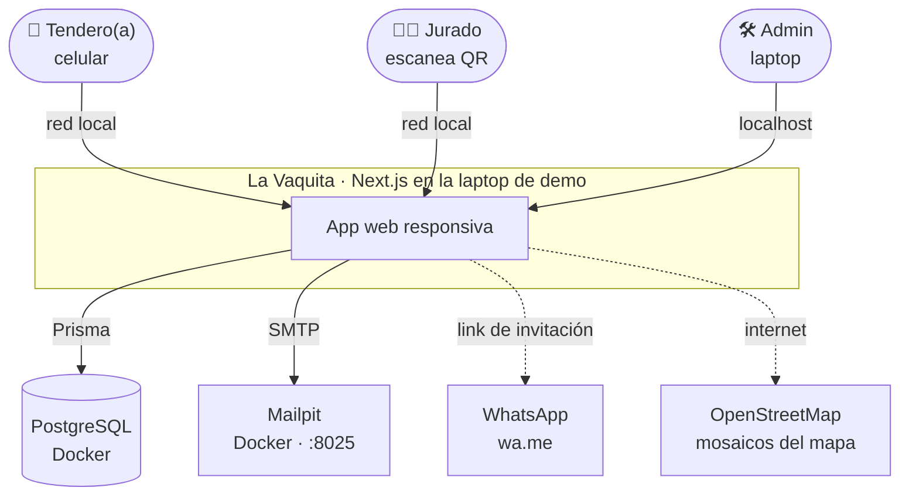

### 4.2 Diagrama de componentes (módulos)

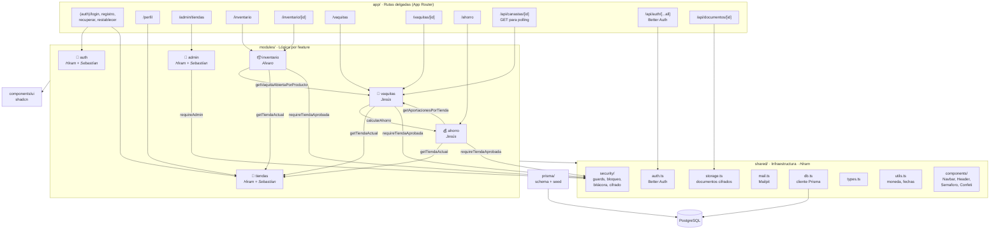

**Reglas de dependencia**
- `app/` → `modules/` → `shared/` → BD. Nunca al revés.
- Entre módulos: **solo** a través de `index.ts` y solo las funciones listadas en §6.
- `ahorro ↔ vaquitas` es la única dependencia mutua permitida: `ahorro` lee aportaciones; `vaquitas` usa la función pura `calcularAhorro`. Para evitar ciclos de import, `calcularAhorro` vive en `modules/ahorro/logic.ts` (sin dependencias).
- **Toda** server action o Route Handler de `inventario`, `vaquitas` y `ahorro` empieza con `requireTiendaAprobada()`; las de `admin` con `requireAdmin()` (RNF-SEC-10).
- En `auth`, `tiendas` y `admin`, Hiram es dueño de `actions.ts`/`queries.ts` y Sebastían de `components/`; el contrato entre ambos es `schemas.ts` (Zod).

### 4.3 Estructura interna de un módulo

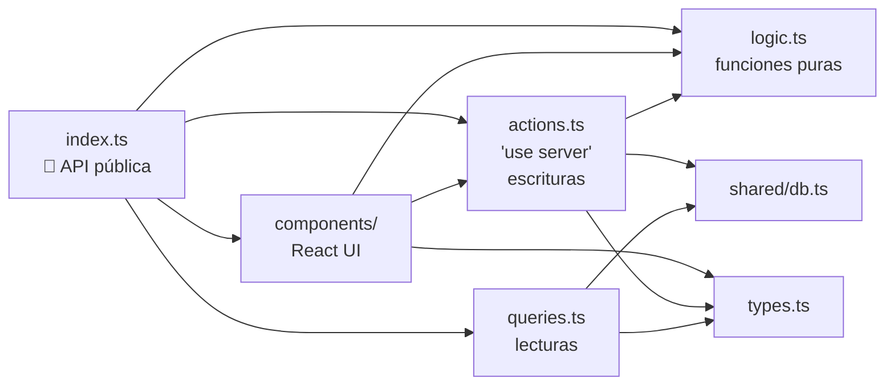

```
modules/<módulo>/
├── components/    # UI del módulo
├── actions.ts     # server actions (mutaciones + validación de RN)
├── queries.ts     # lecturas Prisma (server)
├── logic.ts       # funciones puras, sin BD ni React (fáciles de probar y explicar)
├── types.ts       # tipos del módulo
└── index.ts       # re-exporta lo público
```

### 4.4 Árbol de carpetas completo

```
src/
├── app/
│   ├── layout.tsx                    # Sebastían
│   ├── (auth)/login|registro|recuperar|restablecer|verificar-correo/page.tsx
│   ├── privacidad/page.tsx           # [RF-TIE-03]
│   ├── perfil/page.tsx               # → tiendas (cualquier estatus)
│   ├── (app)/layout.tsx              # requireTiendaAprobada() [RF-VER-05]
│   ├── (app)/inventario/page.tsx     # → inventario
│   ├── (app)/inventario/[id]/page.tsx
│   ├── (app)/vaquitas/page.tsx       # → vaquitas
│   ├── (app)/vaquitas/[id]/page.tsx
│   ├── (app)/ahorro/page.tsx         # → ahorro
│   ├── admin/layout.tsx              # requireAdmin()
│   ├── admin/tiendas/page.tsx        # → admin
│   ├── admin/tiendas/[id]/page.tsx
│   └── api/
│       ├── auth/[...all]/route.ts    # Better Auth
│       ├── canastas/[id]/route.ts    # → vaquitas
│       └── documentos/[id]/route.ts  # admin o dueño [RNF-SEC-10]
├── modules/
│   ├── auth/
│   ├── tiendas/
│   ├── admin/
│   ├── inventario/
│   ├── vaquitas/
│   └── ahorro/
├── shared/
│   ├── db.ts
│   ├── auth.ts · auth-client.ts      # Better Auth
│   ├── security/                     # guards, password, lockout, audit, crypto, uploads, rate-limit
│   ├── storage.ts                    # documentos cifrados
│   ├── mail.ts                       # Mailpit
│   ├── types.ts
│   ├── utils.ts
│   ├── demo.ts                       # reiniciarDemo() [RF-DEM-02]
│   └── components/
├── components/ui/                    # shadcn (generado)
└── middleware.ts                     # sin sesión → /login [RF-TIE-02]
prisma/
├── schema.prisma
└── seed.ts
```

### 4.5 Diagrama de despliegue

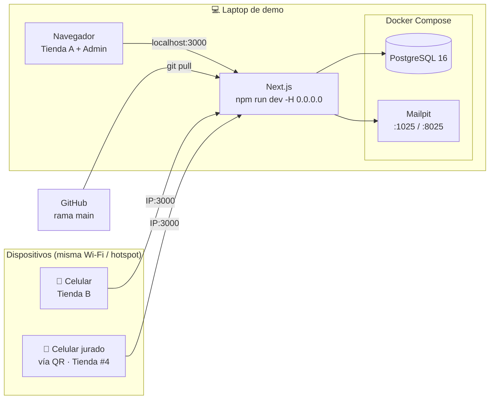

---

## 5. Modelo de datos

### 5.1 Diagrama entidad-relación

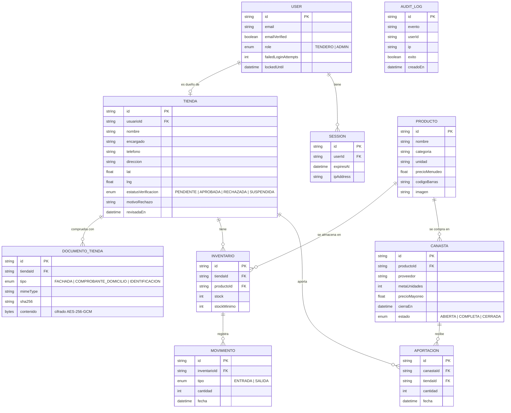

### 5.2 Diagrama de estados — Vaquita (`Canasta`)

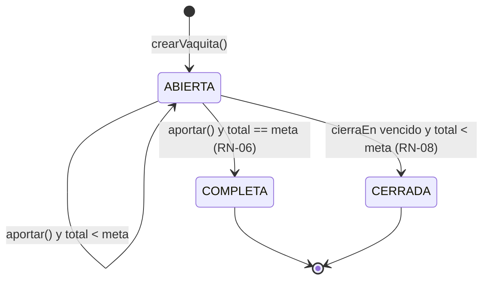

### 5.2.1 Diagrama de estados — Verificación de tienda (RN-16)

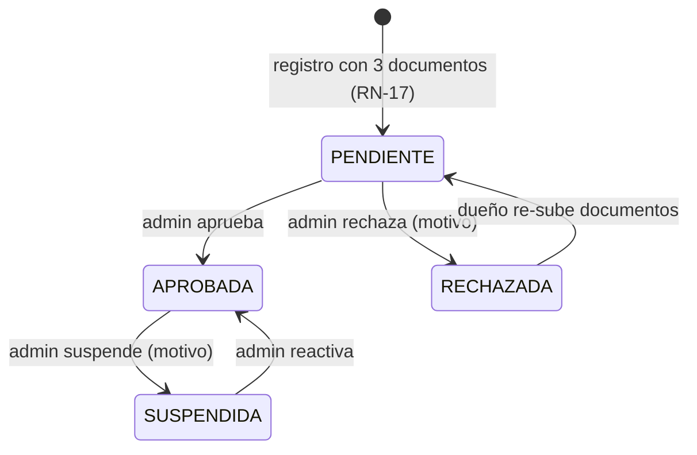

### 5.3 Esquema Prisma (contrato)

```prisma
generator client {
  provider = "prisma-client-js"
}

datasource db {
  provider = "postgresql"
  url      = env("DATABASE_URL")
}

// ── Better Auth ─────────────────────────────────────────────
// User, Session, Account, Verification y RateLimit se generan con
// `npx @better-auth/cli generate`. Campos propios agregados a User
// (declarados en user.additionalFields con input: false):
//
//   role                Rol       @default(TENDERO)
//   failedLoginAttempts Int       @default(0)
//   lockedUntil         DateTime?
//   tienda              Tienda?

model Tienda {
  id                  String              @id @default(cuid())
  usuarioId           String              @unique
  nombre              String
  encargado           String
  telefono            String
  direccion           String
  lat                 Float
  lng                 Float
  estatusVerificacion EstatusVerificacion @default(PENDIENTE)
  motivoRechazo       String?
  enviadaEn           DateTime            @default(now())
  revisadaEn          DateTime?
  revisadaPorId       String?
  usuario             User                @relation(fields: [usuarioId], references: [id], onDelete: Cascade)
  documentos          DocumentoTienda[]
  inventario          Inventario[]
  aportaciones        Aportacion[]

  @@index([estatusVerificacion])
}

model DocumentoTienda {
  id        String        @id @default(cuid())
  tiendaId  String
  tipo      TipoDocumento
  mimeType  String
  tamano    Int
  sha256    String
  iv        Bytes
  authTag   Bytes
  contenido Bytes         // cifrado AES-256-GCM; consultar SIEMPRE con select para no cargarlo en listados
  creadoEn  DateTime      @default(now())
  tienda    Tienda        @relation(fields: [tiendaId], references: [id], onDelete: Cascade)

  @@index([tiendaId, tipo])
}

model AuditLog {
  id        String   @id @default(cuid())
  evento    String
  userId    String?
  objetivo  String?
  ip        String?
  userAgent String?
  exito     Boolean
  detalle   Json?
  creadoEn  DateTime @default(now())

  @@index([userId, creadoEn])
}

model Producto {
  id            String       @id @default(cuid())
  nombre        String
  categoria     String
  unidad        String
  precioMenudeo Float
  codigoBarras  String?      @unique
  imagen        String?
  inventarios   Inventario[]
  canastas      Canasta[]
}

model Inventario {
  id          String       @id @default(cuid())
  tiendaId    String
  productoId  String
  stock       Int
  stockMinimo Int
  tienda      Tienda       @relation(fields: [tiendaId], references: [id], onDelete: Cascade)
  producto    Producto     @relation(fields: [productoId], references: [id], onDelete: Cascade)
  movimientos Movimiento[]

  @@unique([tiendaId, productoId])
}

model Movimiento {
  id           String     @id @default(cuid())
  inventarioId String
  tipo         TipoMov
  cantidad     Int
  fecha        DateTime   @default(now())
  inventario   Inventario @relation(fields: [inventarioId], references: [id], onDelete: Cascade)

  @@index([inventarioId, fecha])
}

model Canasta {
  id            String        @id @default(cuid())
  productoId    String
  proveedor     String
  metaUnidades  Int
  precioMayoreo Float
  cierraEn      DateTime
  estado        EstadoCanasta @default(ABIERTA)
  creadaEn      DateTime      @default(now())
  producto      Producto      @relation(fields: [productoId], references: [id], onDelete: Cascade)
  aportaciones  Aportacion[]

  @@index([productoId, estado])
}

model Aportacion {
  id        String   @id @default(cuid())
  canastaId String
  tiendaId  String
  cantidad  Int
  fecha     DateTime @default(now())
  canasta   Canasta  @relation(fields: [canastaId], references: [id], onDelete: Cascade)
  tienda    Tienda   @relation(fields: [tiendaId], references: [id], onDelete: Cascade)
}

enum TipoMov {
  ENTRADA
  SALIDA
}

enum EstadoCanasta {
  ABIERTA
  COMPLETA
  CERRADA
}

enum Rol {
  TENDERO
  ADMIN
}

enum EstatusVerificacion {
  PENDIENTE
  APROBADA
  RECHAZADA
  SUSPENDIDA
}

enum TipoDocumento {
  FACHADA
  COMPROBANTE_DOMICILIO
  IDENTIFICACION
}
```

> Nota: se usa `Float` para precios por simplicidad del hackathon. En producción se usaría `Decimal`.

### 5.4 Datos semilla (RF-DEM-01)

| Elemento | Valor |
| :--- | :--- |
| Colonia | Una colonia real de Morelia (ej. *Chapultepec Norte*) |
| Tiendas | **Abarrotes Doña Lupe** · **Miscelánea El Güero** · **Tienda La Esperanza** (coordenadas cercanas entre sí) |
| Productos (~10) | Coca-Cola 600 ml, Sabritas 45 g, Pan Bimbo, Huevo (kg), Aceite 1 L, Frijol 1 kg, Arroz 1 kg, Maseca 1 kg, Leche 1 L, Papel higiénico 4 pzas |
| Inventario | Cada tienda con los 10 productos; **2–3 en 🔴** por tienda (incluyendo Coca-Cola en Doña Lupe) |
| Movimientos | SALIDAS diarias de los últimos 7 días (para RN-07) |
| Vaquita ABIERTA | Coca-Cola · Central de Abastos Morelia · meta **100** · aportado **70** (Güero 40 + Esperanza 30) · cierra en 2 días |
| Vaquita COMPLETA | Maseca · meta 50 · Doña Lupe 20 + Güero 15 + Esperanza 15 |
| Cuentas (RF-DEM-03) | 1 **admin** · 1 dueño verificado por tienda (tiendas **APROBADAS**) · **"Tienda #4"** aprobada para el jurado · **1 tienda PENDIENTE** ("Abarrotes San Juan") con fachada, comprobante e INE de muestra. Contraseñas desde `.env` |

---

## 6. Interfaces y contratos

### 6.1 Rutas de UI

| Ruta | Requisitos | Módulo |
| :--- | :--- | :--- |
| `/login` | RF-AUT-01 | auth |
| `/registro` | RF-VER-01…04 | tiendas |
| `/verificar-correo` | RF-AUT-02 | auth |
| `/recuperar`, `/restablecer` | RF-AUT-05, RF-AUT-06 | auth |
| `/privacidad` | RF-TIE-03 | tiendas |
| `/perfil` | RF-VER-05, RF-VER-07 | tiendas |
| `/admin/tiendas`, `/admin/tiendas/[id]` | RF-VER-06, RF-VER-08 | admin |
| `/inventario` | RF-INV-01…05 | inventario |
| `/inventario/[id]` *(id = Inventario.id)* | RF-INV-06…09 | inventario |
| `/vaquitas` | RF-VAQ-01, RF-VAQ-06 | vaquitas |
| `/vaquitas/[id]` | RF-VAQ-02…05, 07…12 | vaquitas |
| `/ahorro` | RF-AHO-01…03 | ahorro |

### 6.2 API HTTP

**`GET /api/canastas/[id]`** — usada por el polling (RF-VAQ-05).

```jsonc
// 200 OK
{
  "id": "ck…",
  "producto": { "id": "ck…", "nombre": "Coca-Cola 600 ml", "precioMenudeo": 18.0 },
  "proveedor": "Central de Abastos Morelia",
  "metaUnidades": 100,
  "totalAportado": 90,
  "faltan": 10,
  "porcentaje": 90,
  "precioMayoreo": 14.5,
  "estado": "ABIERTA",          // ya evaluado con RN-08
  "cierraEn": "2026-11-21T23:59:00.000Z",
  "aportaciones": [
    { "tiendaId": "ck…", "tienda": "Miscelánea El Güero", "cantidad": 60 },
    { "tiendaId": "ck…", "tienda": "Tienda La Esperanza", "cantidad": 30 }
  ]
}
// 401 sin sesión · 403 tienda no aprobada · 404 { "error": "Vaquita no encontrada" }
```

**`GET /api/documentos/[id]`** — ver un documento de verificación (RNF-SEC-09, RNF-SEC-10).

- Solo **ADMIN** o el **dueño** de la tienda. Si no, `403`; sin sesión, `401`.
- Responde el archivo descifrado con su `Content-Type`, `Content-Disposition: inline`, `Cache-Control: no-store` y `X-Content-Type-Options: nosniff`.
- Registra `DOC_VISTO` en `AuditLog`.

**`/api/auth/[...all]`** — endpoints de Better Auth (`/sign-in/email`, `/sign-out`, `/forget-password`, `/reset-password`, `/verify-email`, etc.), con rate limit (RNF-SEC-04).

### 6.3 Contratos de módulo (`index.ts`)

Tipo de retorno estándar para acciones:

```ts
// shared/types.ts
export type Resultado<T = void> =
  | { ok: true; data: T }
  | { ok: false; error: string }; // mensaje listo para mostrar al usuario
```

> 🔒 **Regla de seguridad:** ninguna acción recibe `tiendaId` desde el cliente para decidir *quién* hace algo. La tienda sale **siempre** de la sesión (`requireTiendaAprobada()`), para evitar que alguien actúe a nombre de otra tienda (IDOR, OWASP A01).

#### `@/shared/security`
```ts
export function requireSession(): Promise<{ usuario: UsuarioDTO }>;                        // sin sesión → /login
export function requireAdmin(): Promise<{ usuario: UsuarioDTO }>;                          // no admin → 403
export function requireTiendaAprobada(): Promise<{ usuario: UsuarioDTO; tienda: TiendaDTO }>; // no aprobada → /perfil o 403
export function registrarEvento(evento: EventoAuditoria, ctx: ContextoAuditoria): Promise<void>; // RNF-SEC-11
export function evaluarIntentoFallido(intentos: number, ahora: Date): { intentos: number; lockedUntil: Date | null }; // RN-14 (pura)
export function cifrar(datos: Buffer): { contenido: Buffer; iv: Buffer; authTag: Buffer };       // AES-256-GCM
export function descifrar(c: { contenido: Buffer; iv: Buffer; authTag: Buffer }): Buffer;
export function validarArchivo(f: File, tipos: readonly MimePermitido[]): Promise<Resultado<{ buffer: Buffer; mime: MimePermitido }>>; // RNF-SEC-08
```

#### `@/modules/auth`
```ts
export { loginSchema, recuperarSchema, restablecerSchema } from "./schemas"; // contrato Hiram ↔ Sebastían
export { LoginForm, RecuperarForm, RestablecerForm, VerificarCorreo } from "./components";
// El login, logout, recuperación y verificación usan authClient (Better Auth) desde los componentes.
```

#### `@/modules/tiendas`
```ts
export { registroSchema } from "./schemas";                              // cuenta + tienda + ubicación + documentos
export function registrarTienda(formData: FormData): Promise<Resultado>;  // RF-VER-01…04 (mensaje genérico, RNF-SEC-06)
export function resubirDocumentos(formData: FormData): Promise<Resultado>; // RF-VER-07 (solo si RECHAZADA)
export function getMiTienda(): Promise<MiTiendaDTO | null>;              // tienda del usuario en sesión, con estatus y motivo
export function getTiendaActual(): Promise<TiendaDTO | null>;            // tienda APROBADA de la sesión
export { RegistroWizard, PerfilTienda, BannerEstatus, HeaderTienda } from "./components";
```

#### `@/modules/admin`
```ts
export function listarTiendasPorEstatus(estatus: EstatusVerificacion): Promise<SolicitudDTO[]>; // sin cargar documentos
export function getTiendaParaRevision(tiendaId: string): Promise<RevisionDTO | null>;           // datos + ids de documentos
export function aprobarTienda(tiendaId: string): Promise<Resultado>;                            // RN-16
export function rechazarTienda(tiendaId: string, motivo: string): Promise<Resultado>;           // motivo obligatorio
export function suspenderTienda(tiendaId: string, motivo: string): Promise<Resultado>;          // COULD
export { TablaSolicitudes, RevisionTienda } from "./components";
```

#### `@/modules/inventario`
```ts
export type NivelStock = "ok" | "bajo" | "critico"; // 🟢 | 🟡 | 🔴

export function getInventarioPorTienda(tiendaId: string): Promise<ItemInventarioDTO[]>;
export function getDetalleInventario(inventarioId: string): Promise<DetalleInventarioDTO | null>;
export function getProductosBajoStock(tiendaId: string): Promise<ItemInventarioDTO[]>;
export function registrarMovimiento(input: {
  inventarioId: string;
  tipo: "ENTRADA" | "SALIDA";
  cantidad: number;
}): Promise<Resultado<{ stock: number }>>;                     // valida RN-02, RN-03 y que el inventario sea de la tienda en sesión

// logic.ts (puras)
export function nivelStock(stock: number, stockMinimo: number): NivelStock;          // RN-01
export function diasParaAgotarse(stock: number, salidasUltimos7Dias: number): number | null; // RN-07
```

#### `@/modules/vaquitas`
```ts
export function listarVaquitas(filtro?: { estado?: EstadoCanasta }): Promise<VaquitaDTO[]>;
export function getVaquita(canastaId: string): Promise<VaquitaDetalleDTO | null>; // mismo shape que §6.2
export function getVaquitaAbiertaPorProducto(productoId: string): Promise<VaquitaDTO | null>; // RN-12
export function getAportacionesPorTienda(tiendaId: string): Promise<AportacionDTO[]>;
export function aportarAVaquita(input: {
  canastaId: string;
  cantidad: number;
}): Promise<Resultado<{ totalAportado: number; estado: EstadoCanasta }>>; // tienda desde la sesión · RN-02, 04, 05, 06 en transacción
export function crearVaquita(input: {
  productoId: string;
  proveedor: string;
  metaUnidades: number;
  precioMayoreo: number;
  cierraEn: Date;
}): Promise<Resultado<{ id: string }>>;                                    // RN-11, RN-12

// logic.ts (puras)
export function estadoEfectivo(estado: EstadoCanasta, cierraEn: Date, total: number, meta: number): EstadoCanasta; // RN-06, RN-08
export function porcentaje(total: number, meta: number): number;
```

#### `@/modules/ahorro`
```ts
export function calcularAhorro(precioMenudeo: number, precioMayoreo: number, cantidad: number): number; // RN-09 (pura)
export function getResumenAhorroTienda(tiendaId: string): Promise<{
  ahorrado: number;
  potencial: number;
  detalle: Array<{ vaquitaId: string; producto: string; cantidad: number; ahorro: number; estado: EstadoCanasta }>;
}>;
export function getResumenAhorroColonia(): Promise<{ ahorrado: number; potencial: number }>;
```

#### `@/shared`
```ts
export const db: PrismaClient;
export function formatoMoneda(n: number): string;      // "$1,234.50" es-MX
export function reiniciarDemo(): Promise<Resultado>;   // RF-DEM-02 · solo ADMIN · no borra cuentas
export const auth: ReturnType<typeof betterAuth>;      // shared/auth.ts (servidor)
export const authClient: ReturnType<typeof createAuthClient>; // shared/auth-client.ts (cliente)
export function enviarCorreo(plantilla: PlantillaCorreo, para: string, datos: Record<string, string>): Promise<void>; // Mailpit
```

> 💡 **Para no bloquearse:** cada dueño publica primero estas firmas en su `index.ts` devolviendo datos mock y después conecta Prisma. Las firmas **no cambian** al conectarlas.

---

## 7. Casos de uso y flujos

### 7.1 Diagrama de casos de uso

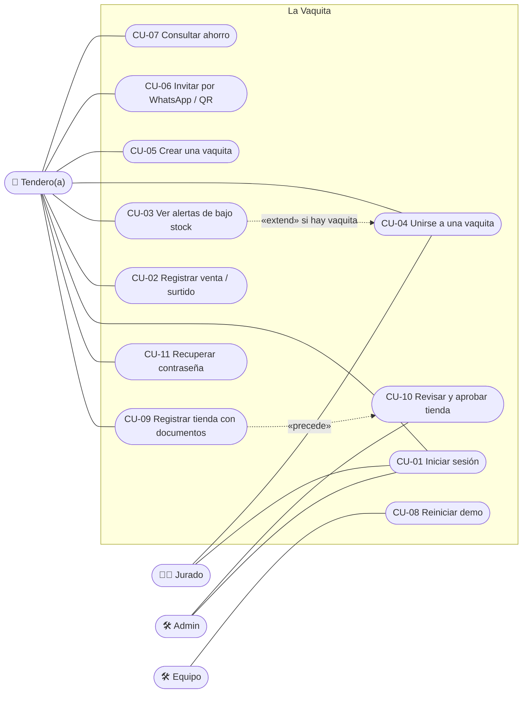

### 7.2 Especificación de casos de uso principales

**CU-09 · Registrar tienda con documentos** (RF-VER-01…04, RF-AUT-02)
| | |
| :--- | :--- |
| Actor | Tendero(a) sin cuenta |
| Precondición | Ninguna |
| Flujo principal | 1. Abre `/registro`. 2. Llena cuenta, datos de la tienda, ubicación en el mapa y sube fachada, comprobante e INE; acepta el aviso de privacidad. 3. El servidor valida todo (Zod + RNF-SEC-08) y aplica el límite por IP. 4. Crea el usuario con Better Auth, la tienda PENDIENTE y los documentos cifrados. 5. Envía el correo de verificación y muestra "Revisa tu correo". |
| Flujo alterno | 3a. Archivo inválido o muy grande → se marca el campo y **no se crea nada**. 4a. Falla al guardar documentos → se borra el usuario creado y se muestra error genérico. 3b. Correo ya registrado → mismo mensaje genérico (RNF-SEC-06). |
| Postcondición | `User` sin verificar, `Tienda` PENDIENTE con 3 `DocumentoTienda`, evento `TIENDA_REGISTRADA`. |

**CU-10 · Revisar y aprobar tienda** (RF-VER-06)
| | |
| :--- | :--- |
| Actor | Admin |
| Precondición | Sesión con rol ADMIN; tienda PENDIENTE |
| Flujo principal | 1. Abre `/admin/tiendas` (pestaña Pendientes). 2. Abre la solicitud: datos, mapa, fachada, comprobante e INE (cada vista registra `DOC_VISTO`). 3. Toca **Aprobar**. 4. La tienda pasa a APROBADA, se guarda quién y cuándo, se registra `TIENDA_APROBADA` y se envía el correo al dueño. |
| Flujo alterno | 3a. Toca **Rechazar** y escribe el motivo (obligatorio) → RECHAZADA + correo con motivo. |
| Postcondición | El dueño ya puede usar inventario, vaquitas y ahorro (o ve el motivo en `/perfil`). |

**CU-11 · Recuperar contraseña** (RF-AUT-05, 06)
| | |
| :--- | :--- |
| Actor | Tendero(a) |
| Flujo principal | 1. En `/login` toca "¿Olvidaste tu contraseña?". 2. Escribe su correo; siempre ve "Si el correo está registrado, te enviamos un enlace". 3. Abre el link (Mailpit) → `/restablecer?token=…`. 4. Escribe la nueva contraseña (RNF-SEC-02). 5. Se cierran todas sus sesiones, se registra `RESET_DONE` y llega el correo "Tu contraseña cambió". |
| Flujo alterno | 3a. Link vencido (> 15 min) o ya usado → "Este enlace ya no sirve" + botón para pedir otro. |

**CU-02 · Registrar venta/surtido** (RF-INV-02, 03, 04)
| | |
| :--- | :--- |
| Actor | Tendero(a) |
| Precondición | Sesión iniciada y tienda APROBADA |
| Flujo principal | 1. Abre `/inventario`. 2. Toca **−** en un producto. 3. El sistema valida RN-02/RN-03, crea el movimiento y actualiza el stock. 4. Si el nivel cambia a 🔴 se actualiza el semáforo y el contador de alertas. |
| Flujo alterno | 2a. Toca la cantidad y escribe N. 3a. Stock insuficiente → toast "No hay unidades para sacar". |
| Postcondición | `Inventario.stock` actualizado y `Movimiento` creado. |

**CU-04 · Unirse a una vaquita** (RF-VAQ-02, 04, 05, 07)
| | |
| :--- | :--- |
| Actor | Tendero(a), Jurado |
| Precondición | Sesión con tienda APROBADA; vaquita ABIERTA vigente |
| Flujo principal | 1. Abre `/vaquitas/[id]` (desde lista, alerta o QR). 2. Elige cantidad (por defecto lo que falta o 10). 3. Toca **"Entrarle a la vaquita"**. 4. El servidor valida RN-02/04/05 y guarda en transacción. 5. Si se llega a la meta → COMPLETA + confeti. 6. Otras pantallas lo ven por polling. |
| Flujo alterno | 4a. Excede lo faltante → "Solo faltan X unidades". 4b. Vaquita ya COMPLETA/CERRADA → "Esta vaquita ya cerró". |
| Postcondición | `Aportacion` creada; estado posiblemente COMPLETA. |

### 7.3 Secuencia — Registrar salida y alerta → vaquita

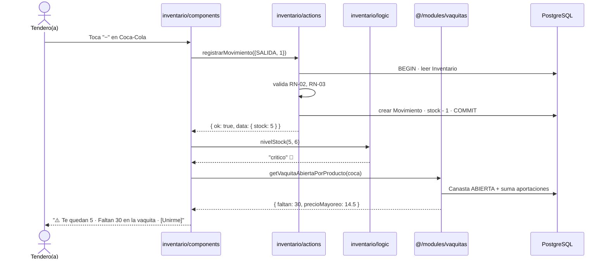

### 7.4 Secuencia — Aportar y propagación en tiempo real

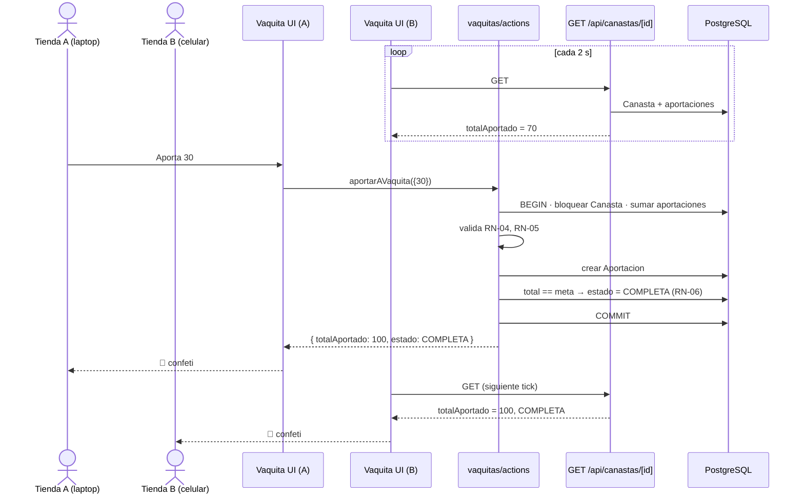

### 7.5 Secuencia — Login con bloqueo por intentos

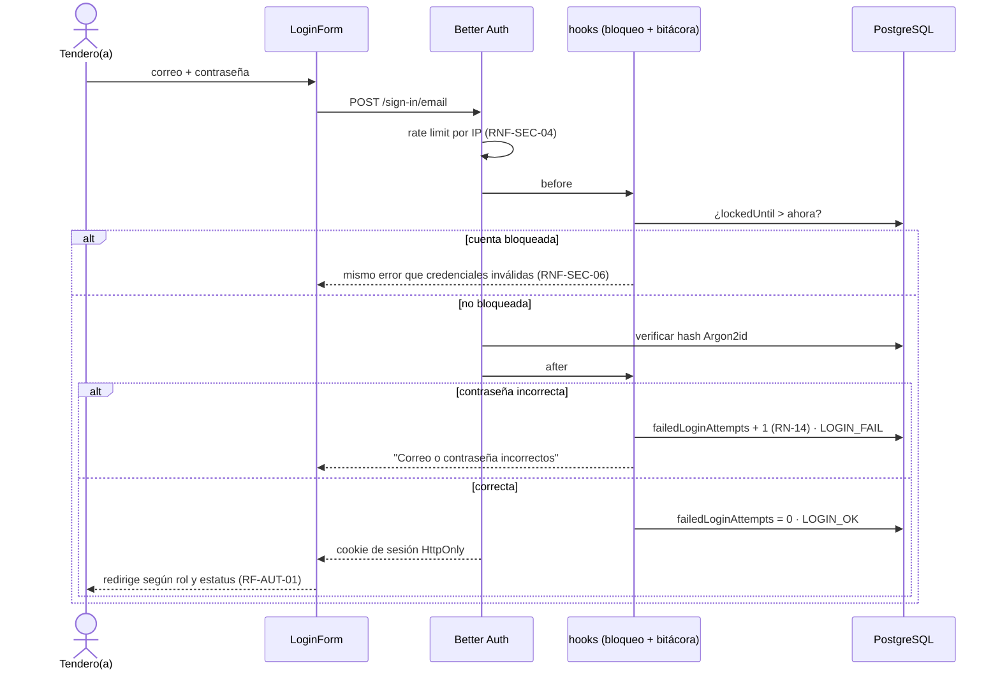

### 7.6 Mapa de navegación

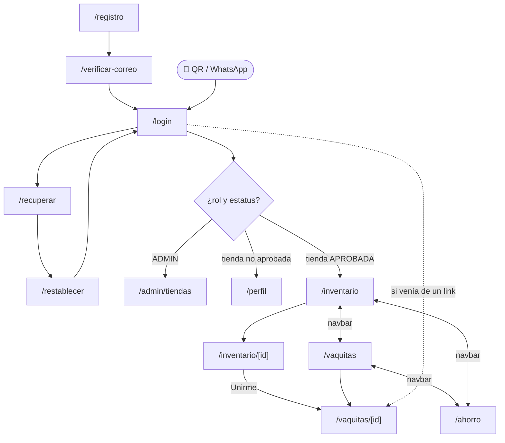

---

## 8. Plan de verificación (pruebas manuales de demo)

> Se ejecuta completo en la **laptop de demo** en los checkpoints 2 (4:00) y final (7:00).

| ID | Prueba | Requisitos | Resultado esperado |
| :--- | :--- | :--- | :--- |
| **PR-01** | Iniciar sesión con el dueño de cada una de las 3 tiendas | RF-AUT-01, RF-TIE-01, RF-DEM-01 | Cada tienda ve su propio inventario y su nombre en el encabezado |
| **PR-02** | Abrir `/inventario` sin sesión | RF-TIE-02 | Redirige a `/login` |
| **PR-03** | Vender hasta que un producto pase a 🔴 | RF-INV-02, 04, RN-01 | Semáforo y contador cambian |
| **PR-04** | Intentar vender con stock 0 | RN-03 | Mensaje de error, stock sigue en 0 |
| **PR-05** | Surtir 10 unidades | RF-INV-03 | Stock +10, semáforo se actualiza |
| **PR-06** | Producto en 🔴 con vaquita abierta | RF-INV-08 | Aparece aviso y lleva a la vaquita |
| **PR-07** | Aportar desde 2 dispositivos a la misma vaquita | RF-VAQ-02, 03, 05, RNF-07 | Ambos ven el progreso en ≤ 3 s |
| **PR-08** | Aportar más de lo que falta | RN-05 | Rechazo "Solo faltan X" |
| **PR-09** | Completar la vaquita | RF-VAQ-04, 07, RN-06 | Estado COMPLETA, confeti, sin botón de aportar |
| **PR-10** | Ver ahorro tras completar | RF-AHO-01, RN-09 | Ahorro correcto en MXN |
| **PR-11** | Escanear QR con otro celular, entrar con "Tienda #4" y aportar | RF-VAQ-10 | Entra por la red local y aporta |
| **PR-12** | Invitar por WhatsApp | RF-VAQ-09 | Abre WhatsApp con mensaje y link |
| **PR-13** | Reiniciar demo | RF-DEM-02 | Vuelve al estado del seed y las cuentas siguen funcionando |
| **PR-14** | Todo el flujo en celular de 360 px | RNF-02, 05 | Sin scroll horizontal, botones cómodos |

### 8.1 Pruebas de login, verificación y seguridad

| ID | Prueba | Requisitos | Resultado esperado |
| :--- | :--- | :--- | :--- |
| **PR-SEC-01** | Registro completo con fotos y PDF | RF-VER-01…04, RF-AUT-02 | Cuenta + tienda PENDIENTE; correo en Mailpit; sin verificar no entra |
| **PR-SEC-02** | Subir `.exe` renombrado a `.jpg`, archivo de 6 MB y PDF como fachada | RNF-SEC-08 | Se rechazan y **no** se crea la cuenta |
| **PR-SEC-03** | Revisar BD en Prisma Studio | RNF-SEC-01, 09 | `Account.password` empieza con `$argon2id$`; `DocumentoTienda.contenido` no se ve como imagen |
| **PR-SEC-04** | Descargar la fachada como admin | RNF-SEC-08 | La imagen no trae EXIF/GPS |
| **PR-SEC-05** | Con tienda PENDIENTE: abrir `/inventario` y llamar `registrarMovimiento` desde DevTools | RF-VER-05, RN-15, RNF-SEC-10 | Redirige a `/perfil` / responde "No autorizado" |
| **PR-SEC-06** | Tendero abre `/admin` y `GET /api/documentos/<id de otra tienda>` | RNF-SEC-10 | 403 en ambos |
| **PR-SEC-07** | Admin aprueba; luego rechaza otra sin motivo y con motivo | RF-VER-06, RN-16 | Aprobada entra a todo; sin motivo no deja; con motivo el dueño lo ve en `/perfil` |
| **PR-SEC-08** | Re-subir documentos tras rechazo | RF-VER-07 | Vuelve a PENDIENTE |
| **PR-SEC-09** | 5 contraseñas incorrectas y luego la correcta | RF-AUT-04, RN-14 | Bloqueada 15 min; `LOGIN_FAIL` ×5 y `ACCOUNT_LOCKED` en `AuditLog` |
| **PR-SEC-10** | Más de 5 intentos de login por minuto desde la misma IP | RNF-SEC-04 | HTTP 429 |
| **PR-SEC-11** | Contraseña de 11 caracteres en registro | RNF-SEC-02 | Rechazada |
| **PR-SEC-12** | `' OR 1=1 --` en correo y campos de texto; `grep -r "Unsafe" src/` | RNF-SEC-03 | Error de validación; grep sin resultados |
| **PR-SEC-13** | Login y recuperación con correo inexistente | RNF-SEC-06 | Mismo mensaje que con uno existente |
| **PR-SEC-14** | Recuperar contraseña: usar el link 2 veces y uno vencido; revisar sesión abierta en otro navegador | RF-AUT-05, 06 | Solo sirve 1 vez y antes de 15 min; la otra sesión se cierra; llega correo de confirmación |
| **PR-SEC-15** | `curl -I http://localhost:3000/login` | RNF-SEC-12 | CSP, `X-Frame-Options`, `nosniff`, `Referrer-Policy` |
| **PR-SEC-16** | Intentar registrar `role: "ADMIN"` agregando el campo al request | RNF-SEC-10, RN-13 | Se ignora; el usuario queda como TENDERO |

Las funciones puras (`nivelStock`, `diasParaAgotarse`, `estadoEfectivo`, `porcentaje`, `calcularAhorro`, `evaluarIntentoFallido`, `cifrar`/`descifrar`) y los esquemas Zod son candidatos a pruebas unitarias rápidas con Vitest.

---

## 9. Fuera de alcance (WON'T)

- Pagos en línea, cobros o divisiones de pago reales.
- Logística/entrega real con proveedores; integración con APIs de distribuidores.
- Fiado / crédito a clientes, punto de venta completo, facturación (CFDI).
- Múltiples colonias; roles distintos de TENDERO y ADMIN; varias tiendas por usuario.
- Verificación automática de documentos (OCR, consulta de INE ante el INE, validación de CURP).
- Autenticación de dos factores (2FA) e inicio de sesión con Google/Facebook.
- Correos reales (SMTP o servicio transaccional): en el MVP solo Mailpit en local.
- Notificaciones push o SMS reales.
- App nativa (se ofrece web responsiva; PWA es opcional).

---

## 10. Decisiones de arquitectura (ADR)

| ID | Decisión | Motivo | Alternativa descartada |
| :--- | :--- | :--- | :--- |
| **ADR-01** | Arquitectura **modular por feature** con API pública en `index.ts` | 4 personas en paralelo sin conflictos de merge; cada dueño explica su módulo en la demo técnica | Carpetas por tipo (`components/`, `lib/`) que mezclan dueños |
| **ADR-02** | **Login con Better Auth** (correo + contraseña, verificación de correo, rate limit) + **verificación manual de tiendas** por un admin | El equipo decidió un login real alineado a OWASP e ISO 27001; la verificación evita tiendas falsas y da confianza a las demás tiendas y a los proveedores | Selector "Entrar como…" con cookie (versión 1.0 de este SRS) |
| **ADR-03** | **Polling cada 2 s** para tiempo real | Funciona con Postgres + Prisma sin infraestructura extra; suficiente para 3–5 clientes | WebSockets / Supabase Realtime (más setup) |
| **ADR-04** | **Server Actions** para mutaciones y un Route Handler solo para el polling | Menos código y tipado de punta a punta | API REST completa |
| **ADR-05** | Catálogo de **Producto global** + `Inventario` por tienda | Permite enlazar la alerta de un producto con la vaquita del mismo producto (RF-INV-08) | Productos duplicados por tienda |
| **ADR-06** | Validación de reglas **en servidor y en transacción** | Dos tiendas aportando al mismo tiempo no deben pasarse de la meta | Validar solo en la UI |
| **ADR-07** | Contraseñas con **Argon2id** en lugar del hash por defecto de Better Auth | Es la primera recomendación del *OWASP Password Storage Cheat Sheet* | scrypt por defecto |
| **ADR-08** | Documentos **cifrados (AES-256-GCM) dentro de PostgreSQL**, detrás de `shared/storage.ts` | Privados por defecto, sin servicios extra, respaldados con la BD; la interfaz permite migrar a almacenamiento de objetos | Carpeta `/public` (expone datos personales) o un bucket externo (más configuración) |
| **ADR-09** | **Demo en local** (Docker: PostgreSQL + Mailpit) con correos solo en Mailpit | Sin cuentas ni costos de correo; la demo no depende del internet de la sede | Deploy en Vercel con SMTP real |

---

## 11. Matriz de trazabilidad

| Requisito | Reto | Módulo | Dueño | Prioridad | Prueba | Rúbrica |
| :--- | :---: | :--- | :--- | :---: | :--- | :--- |
| RF-AUT-01…03 | Equipo | auth | Hiram + Sebastían | MUST | PR-01, 02, PR-SEC-01 | Ejecución y estabilidad, Navegación |
| RF-AUT-04…08 | Equipo | auth | Hiram + Sebastían | SHOULD/COULD | PR-SEC-09…14 | Lógica y manejo de datos |
| RF-VER-01…06 | Equipo | tiendas, admin | Hiram + Sebastían | MUST | PR-SEC-01…07 | Viabilidad, Funcionalidades esenciales |
| RF-VER-07, 08 | Equipo | tiendas, admin | Hiram + Sebastían | SHOULD/COULD | PR-SEC-08 | Viabilidad |
| RF-TIE-01…04 | — | tiendas | Sebastían | MUST | PR-01, 02 | Navegación, Claridad visual |
| RNF-SEC-01…14 | Equipo | shared/security | Hiram | MUST | PR-SEC-01…16 | Dominio y argumentación, Viabilidad |
| RF-INV-01…04 | R1 | inventario | Alvaro | MUST | PR-03, 04, 05 | Funcionalidades esenciales |
| RF-INV-05…07 | R1 | inventario | Alvaro | SHOULD | PR-03 | Lógica y manejo de datos |
| RF-INV-08 | R1+R2 | inventario | Alvaro | SHOULD | PR-06 | Flujo principal, Integración |
| RF-VAQ-01…05 | R2 | vaquitas | Jesús | MUST | PR-07, 08, 09 | Flujo principal, Integración y respuesta |
| RF-VAQ-06…08 | R2 | vaquitas | Jesús | SHOULD | PR-09 | Funcionalidades esenciales |
| RF-VAQ-09, 10 | R2 | vaquitas | Jesús | SHOULD | PR-11, 12 | Pertinencia en México |
| RF-AHO-01…03 | — | ahorro | Jesús | MUST/SHOULD | PR-10 | Beneficio al usuario |
| RF-DEM-01…03 | R3 | shared/prisma | Hiram | MUST/SHOULD | PR-01, 13 | Ejecución y estabilidad |
| RNF-01…05 | — | todos | Sebastían (revisa) | MUST | PR-14 | UX/UI (15 pts) |
| RNF-06…09 | — | todos | Hiram (revisa) | MUST | PR-07 | Ejecución y estabilidad |

---

## 12. Historial de cambios

| Versión | Fecha | Autor | Cambio |
| :--- | :--- | :--- | :--- |
| 1.0 | 2026-11-19 | Equipo REYES | Versión inicial |
| 1.1 | 2026-11-19 | Equipo REYES | Login seguro con Better Auth (RF-AUT), verificación de tiendas con documentos y aprobación de admin (RF-VER), requisitos de seguridad OWASP/ISO 27001 (RNF-SEC), RN-13…17, demo en local con Mailpit, nuevo reparto (Ahorro y WhatsApp/QR → Jesús), ADR-02 reemplazado y ADR-07…09 |
