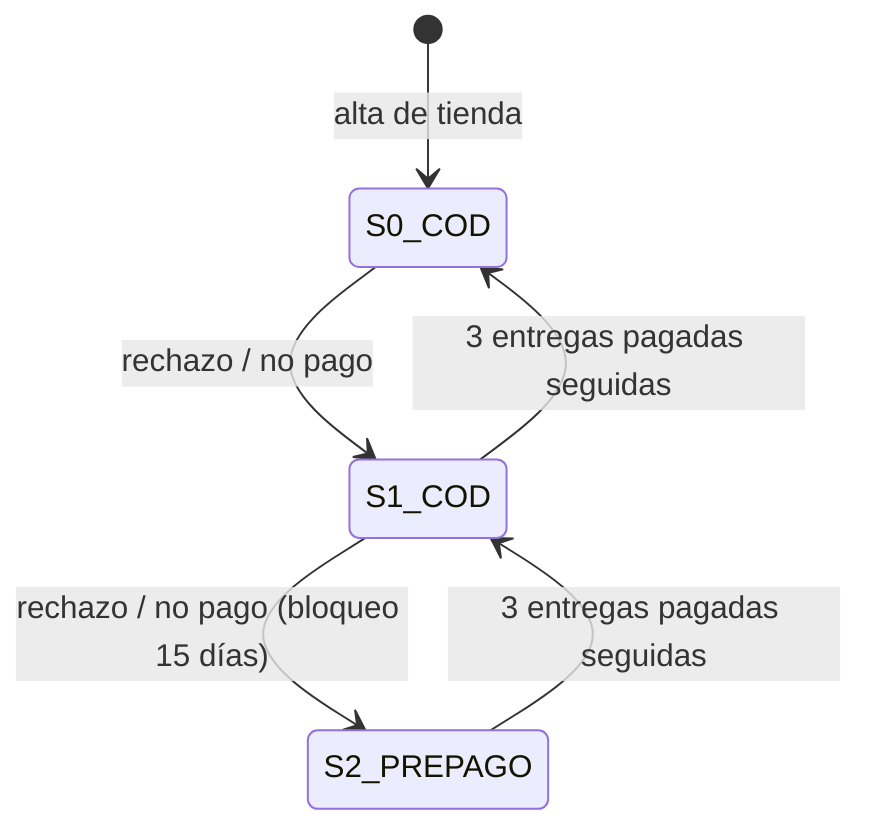

# 🐄 Plan de Batalla — HackaPony 2026 · Equipo REYES

> **Proyecto:** *La Vaquita* — inventario rápido + compras en grupo para tienditas de colonia.
> **Tiempo:** 8 horas. **Meta:** demo en vivo estable, bonita y ensayada. Nada de "eso solo está en la diapositiva".
> 📘 **Requisitos, diagramas y contratos:** [`SRS.md`](SRS.md) — la fuente de verdad para personas y agentes.

**Contenido:** [Ficha del reto](#-ficha-técnica-del-reto) · [Prerrequisitos](#-prerrequisitos-antes-del-día) · [Roles](#-roles) · [Cronograma](#️-cronograma-8-h) · [Modelo de datos](#️-modelo-de-datos-contrato) · [Arquitectura modular](#-arquitectura-modular) · [Login y verificación](#-login-y-verificación-de-tiendas) · [Git](#-git-sin-dramas) · [Presentación](#-presentación) · [Plan B](#-plan-b) · [Visión a producción](#-anexo-visión-a-producción-post-hackathon)

---

## 📋 Ficha técnica del reto

* **Institución:** Instituto Tecnológico de Morelia (H. Concejo Estudiantil)
* **Reto 01:** Comercio Local y PyMEs
* **Nombre del equipo:** REYES
* **Turno / Expo #:** *(Pendiente)*

### 📌 Problemática asignada
**Resiliencia Barrial: Compras en Grupo e Inventario Rápido**

* **Contexto en México:** Las tienditas de abarrotes y comercios de colonia pierden margen de ganancia frente a grandes cadenas porque compran insumos al menudeo y carecen de un control ágil sobre los productos que están por agotarse.
* **Misión del equipo:** Construir una aplicación web o móvil sencilla donde comerciantes de una misma zona registren su inventario básico y se unan a *"canastas de compra colectiva"* para alcanzar precios de mayoreo.

### ⚙️ Requerimientos mínimos del prototipo (MVP)
- [ ] **Catálogo simple** con control de stock (entradas/salidas y alerta visual de bajo inventario).
- [ ] **Módulo de "Pedido Grupal"** donde 2 o más tiendas suman unidades de un producto hasta completar la meta de mayoreo.
- [ ] **Demo funcional** cargada con datos simulados de al menos 3 tiendas de una colonia.

### 🛠️ Stack tecnológico
* **Framework fullstack:** Next.js (ya incluye React de forma nativa)
* **Lenguaje:** TypeScript (esencial para aprovechar Prisma, shadcn y Better Auth al 100%)
* **Estilos:** Tailwind CSS
* **Componentes UI:** shadcn/ui
* **Base de datos:** PostgreSQL
* **ORM:** Prisma
* **Autenticación:** Better Auth — login seguro (OWASP + ISO/IEC 27001) con verificación de tiendas. Ver [Login y verificación de tiendas](#-login-y-verificación-de-tiendas).

### ⏱️ Tiempo de desarrollo y reglas de exposición

**Tiempo límite de desarrollo**
* **8 horas continuas** para desarrollar el Producto Mínimo Viable (MVP) funcional.
* Libertad tecnológica: se puede utilizar cualquier lenguaje, framework, API pública, datos simulados o herramientas de IA.
* **Entregables:** No se solicita documentación escrita ni manuales. La evaluación se realizará al día siguiente conforme al turno asignado.

**Reglas de presentación**
* **Formato libre:** Se permite el apoyo de diapositivas, cartel o material visual.
* **Penalizaciones:** Es obligatorio respetar estrictamente los tiempos máximos; de lo contrario, se aplicará puntaje negativo.
* **Importante:** *No se otorgarán puntos por funcionalidades que solo aparezcan en diapositivas y no se demuestren en vivo.*

**Estructura de la evaluación**

| Fase | Participantes | Tiempo máx. | Enfoque de la evaluación |
| :--- | :--- | :--- | :--- |
| **1. Exposición del proyecto** | Integrantes que gusten participar | 5 minutos | Demostración en vivo del prototipo y explicación general (no técnica): problemática atendida, propuesta desarrollada, costos, requerimientos y funcionamiento. |
| **2. Demostración técnica** | Integrantes que gusten participar | 5 minutos | Explicación de los aspectos técnicos del proyecto, arquitectura, tecnologías utilizadas, navegación completa e implementación del código. |
| **3. Preguntas del jurado** | Todo el equipo | 5 minutos | Sesión de preguntas y respuestas del jurado hacia el equipo sobre la propuesta, su funcionamiento y las decisiones técnicas de su desarrollo. |

### 🏆 Rúbrica oficial de evaluación (total: 100 puntos)

| Criterio | Puntaje máx. | Sub-indicadores evaluados por el jurado |
| :--- | :---: | :--- |
| **1. Prototipo funcional (código)** | **45 pts** | • Ejecución y estabilidad (10 pts)<br>• Flujo principal del MVP (15 pts)<br>• Funcionalidades esenciales (10 pts)<br>• Lógica y manejo de datos (7 pts)<br>• Integración y respuesta (3 pts) |
| **2. Impacto y pertinencia en México** | **25 pts** | • Comprensión del problema (6 pts)<br>• Pertinencia de la solución en México (8 pts)<br>• Beneficio para el usuario objetivo (6 pts)<br>• Viabilidad de la propuesta (5 pts) |
| **3. Experiencia de usuario (UX/UI)** | **15 pts** | • Claridad visual (4 pts)<br>• Navegación (4 pts)<br>• Comprensión inmediata (4 pts)<br>• Adaptación al usuario objetivo (3 pts) |
| **4. Pitch y claridad de presentación** | **15 pts** | • Explicación del problema y propuesta (4 pts)<br>• Demostración del producto (5 pts)<br>• Dominio y argumentación (4 pts)<br>• Comunicación y tiempo (2 pts) |

---

## 🧰 Prerrequisitos (antes del día)

Cada integrante llega con esto **ya instalado y probado**. Instalar cosas el día del hackathon se come la primera hora.

- [ ] **Node.js 22 LTS** (la misma versión del `Dockerfile`): `winget install OpenJS.NodeJS.LTS` o desde nodejs.org.
- [ ] **Docker Desktop** para levantar PostgreSQL y Mailpit con `docker compose up -d postgres mailpit`.
- [ ] **Git** con acceso al repo y la rama propia descargada.
- [ ] Editor con extensiones de **Prisma**, **Tailwind CSS** y **ESLint**.
- [ ] **`.env`** copiado de `.env.example`. Hiram comparte por el chat privado los valores comunes; cada quien genera su `BETTER_AUTH_SECRET` y su `DOCS_ENCRYPTION_KEY` con `openssl rand -base64 32`.
- [ ] Probar que `docker compose up -d postgres` arranca y que `localhost:8025` (Mailpit) abre.

> 💻 **La demo corre en local** (laptop de demo con Docker). Los correos de verificación y recuperación llegan a **Mailpit** (`localhost:8025`); no se configura SMTP real. Vercel queda solo como respaldo público opcional, y ahí los correos **no** llegan.

---

## 👥 Roles

Cada quien es **dueño** de una parte: decide, la construye y la explica en la presentación. Si alguien se atora más de 20 min, **grita** y otro le echa la mano.

| Integrante | Rol | Es dueño de… | Rama |
| :--- | :--- | :--- | :--- |
| **Hiram** | 🏗️🔐 **El Arquitecto** (Tech Lead / Backend + Seguridad) | Proyecto base, Docker, BD, Prisma, seed · **Better Auth**, guards de acceso, bloqueo por intentos, recuperación de contraseña, bitácora, cifrado de documentos, correos (Mailpit) · server actions de registro y de admin | `hiram` |
| **Alvaro** | 📦 **El Bodeguero** (Módulo Inventario) | Catálogo, stock, entradas/salidas (`registrarMovimiento`), alertas, predicción "se acaba en X días", alerta → vaquita | `Alvaro` |
| **Jesús** | 🛒💰 **El de la Vaquita** (Pedido Grupal + Ahorro) | Vaquitas, aportaciones (`aportarAVaquita`), barra en tiempo real, meta cumplida 🎉 · **pantalla de Ahorro** · WhatsApp/QR de la vaquita | `Jesús` |
| **Sebastían** | 🎨🪪 **El Marchante** (UX/UI + Verificación + Pitch) | Layout, navegación, diseño · **pantallas de login, registro de tienda en 4 pasos, perfil y panel de admin** · aviso de privacidad · diapositivas y guion | `Sebastían` |

**Cómo se reparte el login entre Hiram y Sebastían:** Hiram hace el **servidor** (`src/shared/auth.ts`, `src/shared/security/*`, `actions.ts` de `auth`, `tiendas` y `admin`) y Sebastían hace las **pantallas** (`components/` de esos mismos módulos). Se ponen de acuerdo en el kickoff sobre los esquemas Zod (`schemas.ts`), que es su contrato.

> ¿No les gusta su rol? Lo cambian en el minuto 0, **no** en la hora 5.

---

## ⏱️ Cronograma (8 h)

```
0:00 ─ 0:30  🤝 KICKOFF (todos juntos)
0:30 ─ 2:00  🔨 BLOQUE 1  · Cimientos
2:00 ─ 2:10  ✅ CHECKPOINT 1
2:10 ─ 4:00  🔨 BLOQUE 2  · Flujo principal
4:00 ─ 4:30  ✅ CHECKPOINT 2 + 🍕 comida (merge a main + prueba en la laptop de demo)
4:30 ─ 6:00  🔨 BLOQUE 3  · Conexión + extras "wow"
6:00         🧊 FREEZE DE FEATURES (ya no se agrega nada nuevo)
6:00 ─ 7:00  🐛 BLOQUE 4  · Pulido, bugs, responsive
7:00         🧊 FREEZE DE CÓDIGO (merge final a main)
7:00 ─ 8:00  🎤 ENSAYO (3 veces con cronómetro) + video de respaldo
```

### 🤝 0:00 – 0:30 · Kickoff (todos)
- [ ] Confirmar roles y nombre **La Vaquita**.
- [ ] Acordar el **modelo de datos** (abajo) — es el contrato entre todos, nadie lo cambia sin avisar.
- [ ] Acordar los **contratos entre módulos** (ver *Arquitectura modular*) y que cada dueño cree su carpeta `src/modules/<módulo>/` con su `index.ts`.
- [ ] Auth ya decidido: **Better Auth + verificación de tiendas** (ver [Login y verificación](#-login-y-verificación-de-tiendas)). Hiram y Sebastían acuerdan los esquemas Zod del login y del registro.
- [x] **El esqueleto del proyecto ya está en `main`, `develop` y en la rama de cada quien**: Next.js, Prisma con el schema completo, seed, Better Auth, guards de seguridad y la carpeta de cada módulo con sus contratos, datos mock y `TODO(<nombre>)`. Cada quien hace `git pull` en su rama, sigue el README y busca sus tareas con `grep -rn "TODO(<tu nombre>)" src`.
- [ ] Hiram (primeros 15 min): `npm install`, `npm run db:migrate` con nombre `init` y **sube la carpeta `prisma/migrations`** para que todos usen la misma migración. Sebastían: `npx shadcn@latest add button input label card form sonner badge dialog textarea tabs progress` y lo sube.
- [ ] Definir las 3 tiendas, ~10 productos y las cuentas demo del seed (ver *Datos simulados*).

---

### 🔨 Bloque 1 · Cimientos (0:30 – 2:00)

| Quién | Tareas |
| :--- | :--- |
| **Hiram** | `create-next-app` (TS + Tailwind) · `shadcn init` · `docker-compose` con Postgres + **Mailpit** · `schema.prisma` completo (MVP + `User`/roles + verificación + `AuditLog`) · **Better Auth** (Argon2id, verificación de correo, rate limit) + `/api/auth` · guards `requireSession` / `requireAdmin` / `requireTiendaAprobada` · seed: admin, 3 tiendas aprobadas, 1 pendiente |
| **Alvaro** | Mientras sale la BD: UI de la tabla/tarjetas de inventario con datos mock · botones **+ / −** grandes · badge de semáforo 🟢🟡🔴 |
| **Jesús** | UI de la lista de vaquitas y del detalle con datos mock · componente `BarraVaquita` (progreso + meta + ahorro) · lista de aportaciones por tienda |
| **Sebastían** | Layout general: navbar inferior (Inventario · Vaquitas · Ahorro) · paleta, logo, tipografía grande · pantalla de **login** · **registro en 4 pasos** con mocks (cuenta → tienda → ubicación con mapa Leaflet → documentos) |

**✅ Checkpoint 1 (2:00):** el proyecto corre en todas las laptops, la BD tiene el seed, **ya se puede iniciar sesión con las cuentas demo** y se ve el layout con mocks.

---

### 🔨 Bloque 2 · Flujo principal (2:10 – 4:00)

| Quién | Tareas |
| :--- | :--- |
| **Hiram** | Server action `registrarTienda` (validación de archivos, cifrado AES-256-GCM, revierte si algo falla) · `aprobarTienda` / `rechazarTienda` · **bloqueo por intentos** fallidos · **recuperación de contraseña** con correo a Mailpit · revisar las transacciones de Alvaro y Jesús |
| **Alvaro** | Conectar inventario a la BD · `registrarMovimiento` (con `requireTiendaAprobada`) · alerta visual de bajo stock · historial de movimientos |
| **Jesús** | Conectar vaquitas a la BD · `aportarAVaquita` en transacción · crear vaquita · `GET /api/canastas/[id]` + **polling cada 2 s** para que la barra suba sola en otra pantalla |
| **Sebastían** | Conectar el registro a `registrarTienda` · pantalla **Perfil** con estatus (en revisión / rechazada con motivo / aprobada) · **panel de admin**: lista de solicitudes, revisión con fotos, documentos y mapa, botones Aprobar / Rechazar |

**✅ Checkpoint 2 (4:00):** 🎯 **el MVP completo funciona**: stock con alertas + 2 tiendas llenan una vaquita en tiempo real + **una tienda nueva se registra, el admin la aprueba y ya puede entrar**. Merge `develop → main`. *A partir de aquí todo es bonus.*

---

### 🔨 Bloque 3 · Conexión + "wow" (4:30 – 6:00)

| Quién | Tareas |
| :--- | :--- |
| **Hiram** | **Bitácora** (`AuditLog`) · headers de seguridad · `GET /api/documentos/[id]` solo para admin y dueño · backend de re-subida de documentos tras rechazo · botón "Reiniciar demo" (**sin borrar** las cuentas demo ni la del admin) |
| **Alvaro** | 🔗 **Alerta → Vaquita**: si un producto está bajo y hay vaquita abierta de ese producto, mostrar "Faltan 12 cajas, te ahorras $3.50/pza · [Unirme]" · predicción "se te acaba en ~3 días" |
| **Jesús** | 🎉 Confeti + "¡Precio de mayoreo desbloqueado!" · cuenta regresiva de cierre · **pantalla de Ahorro** ("ahorraste $420") · 📲 **Invitar por WhatsApp** (`wa.me/?text=`) + **QR** de la vaquita |
| **Sebastían** | Pantallas de **recuperar / restablecer contraseña** · página de **aviso de privacidad** · re-subir documentos desde el perfil · responsive y estados vacíos/de carga · terminar diapositivas |

**Extras solo si sobra tiempo (en este orden):** escáner de código de barras (`html5-qrcode`) → mapa de la colonia (Leaflet; ya se usa en el registro) → revisar contraseñas filtradas (plugin HIBP) → dictado por voz.

---

### 🐛 Bloque 4 · Pulido (6:00 – 7:00)
- **Todos** prueban el flujo completo en celular y laptop, y anotan bugs en el chat del equipo.
- Cada dueño arregla los bugs de su módulo. **Cero features nuevas.**
- Hiram corre la **lista de pruebas de seguridad** del SRS (§8): bloqueo, archivos inválidos, acceso sin aprobar, inyección SQL.
- Sebastían revisa textos, ortografía y que todo se entienda sin explicar.
- Hiram hace el merge final a `main` a las **7:00** y deja lista la **laptop de demo** (Docker arriba, seed cargado, sesiones iniciadas).

### 🎤 Ensayo (7:00 – 8:00)
- 3 ensayos completos con cronómetro (5 + 5 min). Si se pasan, se recorta texto, no demo.
- Grabar un **video de respaldo** de la demo por si falla el internet.
- Preparar respuestas para el jurado (ver abajo).

---

## 🗄️ Modelo de datos (contrato)

```prisma
// User, Session, Account, Verification y RateLimit los genera Better Auth
// (npx @better-auth/cli generate). A User se le agregan:
//   role                Rol       @default(TENDERO)   // input: false
//   failedLoginAttempts Int       @default(0)
//   lockedUntil         DateTime?
//   tienda              Tienda?

model Tienda {
  id                  String              @id @default(cuid())
  usuarioId           String              @unique      // dueño (User de Better Auth)
  nombre              String              // "Abarrotes Doña Lupe"
  encargado           String
  telefono            String
  direccion           String
  lat                 Float
  lng                 Float
  estatusVerificacion EstatusVerificacion @default(PENDIENTE)
  motivoRechazo       String?
  enviadaEn           DateTime            @default(now())
  revisadaEn          DateTime?
  revisadaPorId       String?
  usuario             User                @relation(fields: [usuarioId], references: [id], onDelete: Cascade)
  documentos          DocumentoTienda[]
  inventario          Inventario[]
  aportaciones        Aportacion[]
}

model DocumentoTienda {     // fachada, comprobante de domicilio, INE
  id        String        @id @default(cuid())
  tiendaId  String
  tipo      TipoDocumento
  mimeType  String
  tamano    Int
  sha256    String
  iv        Bytes
  authTag   Bytes
  contenido Bytes         // cifrado AES-256-GCM; consultar SIEMPRE con select
  creadoEn  DateTime      @default(now())
  tienda    Tienda        @relation(fields: [tiendaId], references: [id], onDelete: Cascade)
}

model AuditLog {
  id        String   @id @default(cuid())
  evento    String   // LOGIN_OK, LOGIN_FAIL, ACCOUNT_LOCKED, TIENDA_APROBADA, DOC_VISTO…
  userId    String?
  objetivo  String?
  ip        String?
  userAgent String?
  exito     Boolean
  detalle   Json?
  creadoEn  DateTime @default(now())
}

model Producto {            // catálogo global (mismo producto en todas las tiendas)
  id            String       @id @default(cuid())
  nombre        String       // "Coca-Cola 600 ml"
  categoria     String
  unidad        String       // "pieza", "caja de 24"
  precioMenudeo Float
  codigoBarras  String?
  imagen        String?
  inventarios   Inventario[]
  canastas      Canasta[]
}

model Inventario {          // stock de un producto en una tienda
  id          String       @id @default(cuid())
  tiendaId    String
  productoId  String
  stock       Int
  stockMinimo Int
  tienda      Tienda       @relation(fields: [tiendaId], references: [id])
  producto    Producto     @relation(fields: [productoId], references: [id])
  movimientos Movimiento[]
  @@unique([tiendaId, productoId])
}

model Movimiento {
  id           String       @id @default(cuid())
  inventarioId String
  tipo         TipoMov      // ENTRADA | SALIDA
  cantidad     Int
  fecha        DateTime     @default(now())
  inventario   Inventario   @relation(fields: [inventarioId], references: [id])
}

model Canasta {             // la "vaquita"
  id            String        @id @default(cuid())
  productoId    String
  proveedor     String        // "Central de Abastos Morelia"
  metaUnidades  Int
  precioMayoreo Float
  cierraEn      DateTime
  estado        EstadoCanasta @default(ABIERTA)
  producto      Producto      @relation(fields: [productoId], references: [id])
  aportaciones  Aportacion[]
}

model Aportacion {
  id        String   @id @default(cuid())
  canastaId String
  tiendaId  String
  cantidad  Int
  fecha     DateTime @default(now())
  canasta   Canasta  @relation(fields: [canastaId], references: [id])
  tienda    Tienda   @relation(fields: [tiendaId], references: [id])
}

enum TipoMov             { ENTRADA SALIDA }
enum EstadoCanasta       { ABIERTA COMPLETA CERRADA }
enum Rol                 { TENDERO ADMIN }
enum EstatusVerificacion { PENDIENTE APROBADA RECHAZADA SUSPENDIDA }
enum TipoDocumento       { FACHADA COMPROBANTE_DOMICILIO IDENTIFICACION }
```

## 🧭 Rutas

| Ruta | Quién entra | Qué muestra | Dueño |
| :--- | :--- | :--- | :--- |
| `/login` | Sin sesión | Correo + contraseña | Sebastían (UI) · Hiram (servidor) |
| `/registro` | Sin sesión | Registro de tienda en 4 pasos con documentos | Sebastían · Hiram |
| `/recuperar`, `/restablecer` | Sin sesión | Pedir link y poner contraseña nueva | Sebastían · Hiram |
| `/verificar-correo` | Sin sesión | "Revisa tu correo" + reenviar | Sebastían · Hiram |
| `/privacidad` | Todos | Aviso de privacidad | Sebastían |
| `/perfil` | Con sesión (cualquier estatus) | Datos de la tienda, estatus de verificación, re-subir documentos | Sebastían |
| `/inventario` | Tienda **aprobada** | Productos de mi tienda, semáforo, + / − | Alvaro |
| `/inventario/[id]` | Tienda aprobada | Detalle, historial, predicción, vaquita sugerida | Alvaro |
| `/vaquitas` | Tienda aprobada | Vaquitas abiertas de la colonia | Jesús |
| `/vaquitas/[id]` | Tienda aprobada | Barra en tiempo real, aportaciones, unirme, QR/WhatsApp | Jesús |
| `/ahorro` | Tienda aprobada | Cuánto ahorró mi tienda y la colonia | Jesús |
| `/admin/tiendas`, `/admin/tiendas/[id]` | **ADMIN** | Solicitudes y revisión (aprobar / rechazar) | Sebastían (UI) · Hiram (servidor) |

## 🧩 Arquitectura modular

El código se organiza **por módulo (feature)**, no por tipo de archivo. Cada módulo tiene un dueño, vive en su propia carpeta y solo expone lo necesario desde su `index.ts`. Así cada quien trabaja en su carpeta sin pisarse y los merges casi no chocan.

```
src/
├── app/                          # SOLO rutas: páginas delgadas que importan módulos
│   ├── layout.tsx                # (Sebastían)
│   ├── (auth)/                   # login, registro, recuperar, restablecer, verificar-correo
│   ├── privacidad/page.tsx
│   ├── perfil/page.tsx           # → modules/tiendas (cualquier usuario con sesión)
│   ├── (app)/                    # layout con requireTiendaAprobada()
│   │   ├── inventario/…          # → modules/inventario
│   │   ├── vaquitas/…            # → modules/vaquitas
│   │   └── ahorro/page.tsx       # → modules/ahorro
│   ├── admin/                    # layout con requireAdmin() → modules/admin
│   └── api/
│       ├── auth/[...all]/route.ts    # Better Auth
│       ├── canastas/[id]/route.ts    # polling de vaquitas
│       └── documentos/[id]/route.ts  # ver documentos (admin o dueño)
├── middleware.ts                 # sin sesión → /login
│
├── modules/
│   ├── auth/                     # 🔐 Hiram (servidor) + 🎨 Sebastían (pantallas)
│   ├── tiendas/                  # 🪪 registro con documentos, perfil, tienda actual (Hiram + Sebastían)
│   ├── admin/                    # 🪪 revisión y aprobación de tiendas (Hiram + Sebastían)
│   ├── inventario/               # 📦 Alvaro
│   ├── vaquitas/                 # 🛒 Jesús
│   └── ahorro/                   # 💰 Jesús
│
├── shared/                       # 🏗️ Hiram (avisar antes de tocar)
│   ├── db.ts                     # cliente Prisma único
│   ├── auth.ts / auth-client.ts  # Better Auth (servidor / cliente)
│   ├── security/                 # guards, contraseñas, bloqueo, bitácora, cifrado, archivos
│   ├── storage.ts                # guardar / leer documentos cifrados
│   ├── mail.ts                   # correos (Mailpit en local)
│   ├── types.ts                  # tipos compartidos
│   ├── utils.ts                  # formatoMoneda, fechas, etc.
│   └── components/               # Navbar, Header, Semaforo, Confeti…
│
└── components/ui/                # shadcn (generado, no editar a mano)

prisma/
├── schema.prisma                 # 🏗️ Hiram
└── seed.ts                       # 🏗️ Hiram
```

### Estructura interna de cada módulo

```
modules/inventario/
├── components/        # UI del módulo (TarjetaProducto, BotonesStock, AlertaBajoStock…)
├── actions.ts         # server actions: registrarMovimiento()
├── queries.ts         # lecturas a BD: getInventarioPorTienda()
├── logic.ts           # funciones puras: esBajoStock(), diasParaAgotarse()
├── types.ts           # tipos propios del módulo
└── index.ts           # 🚪 API pública: lo único que otros módulos pueden importar
```

### Reglas del juego modular

1. **Cada quien solo edita su carpeta de módulo.** Fuera de ella, avisa en el chat.
2. **Entre módulos solo se importa desde `index.ts`.** ✅ `import { getVaquitaAbierta } from "@/modules/vaquitas"` · ❌ `import ... from "@/modules/vaquitas/queries"`.
3. **Las páginas en `app/` son delgadas:** importan el componente del módulo y ya, sin lógica.
4. **Lógica pura en `logic.ts`** (sin BD ni React): se explica fácil en la demo técnica y se puede probar sola.
5. **`shared/` es de Hiram.** Si alguien necesita algo ahí, lo pide o lo propone en un PR chiquito.
6. **Los contratos entre módulos se acuerdan en el kickoff** y no se cambian sin avisar:

| Módulo que expone | Función | La usa |
| :--- | :--- | :--- |
| `shared/security` | `requireTiendaAprobada()` → `{ usuario, tienda }` | **todas** las server actions y páginas de inventario, vaquitas y ahorro |
| `shared/security` | `requireAdmin()` | módulo `admin` |
| `tiendas` | `getTiendaActual()` (sale de la sesión) | todos |
| `vaquitas` | `getVaquitaAbiertaPorProducto(productoId)` | inventario (alerta → vaquita) |
| `vaquitas` | `getAportacionesPorTienda(tiendaId)` | ahorro |
| `inventario` | `getProductosBajoStock(tiendaId)` | vaquitas (sugerir vaquitas) |
| `ahorro` | `calcularAhorro(menudeo, mayoreo, cantidad)` | vaquitas (barra con ahorro) |

> 💡 Para no bloquearse: el dueño del módulo publica **primero la firma** de la función en su `index.ts` con datos falsos (`return mock`) y luego la conecta a la BD. Así el que la consume puede avanzar desde el minuto uno.

---

## 🏪 Datos simulados (seed)

- **Colonia:** una colonia real de Morelia (ej. Colonia Chapultepec Norte).
- **Tiendas:** 🏪 Abarrotes Doña Lupe · 🏪 Miscelánea El Güero · 🏪 Tienda La Esperanza.
- **~10 productos:** Coca-Cola 600 ml, Sabritas, Bimbo, huevo, aceite, frijol, arroz, Maseca, leche, papel higiénico.
- **Dejar a propósito:** 2–3 productos en rojo 🔴, una vaquita al **70 %** (para completarla en vivo) y otra ya **COMPLETA** (para mostrar el ahorro).
- **Cuentas:** 1 **admin**, 1 dueño por cada tienda (correo verificado y tienda **APROBADA**), 1 cuenta **"Tienda #4"** aprobada para el jurado y 1 tienda **PENDIENTE** con documentos de ejemplo (fotos de muestra) para **aprobarla en vivo**. Las contraseñas salen de `.env` (`ADMIN_PASSWORD`, `SEED_DEMO_PASSWORD`), nunca del código.

---

## 🔐 Login y verificación de tiendas

Login seguro con **Better Auth**, basado en **OWASP** (Top 10, ASVS, Cheat Sheets) e **ISO/IEC 27001:2022** (Anexo A). El detalle de requisitos, controles y pruebas está en el [SRS](SRS.md) (RF-AUT, RF-VER, RNF-SEC).

### Flujo

```
/registro (4 pasos, un solo envío)
  1. Cuenta: nombre, correo, contraseña
  2. Tienda: nombre del negocio, dirección, teléfono
  3. Ubicación: pin en el mapa ("Usar mi ubicación" o ajuste manual)
  4. Documentos: foto de la fachada, comprobante de domicilio, INE del dueño + aviso de privacidad
        │
        ▼  se valida TODO antes de crear la cuenta
  correo de verificación (Mailpit) → verifica → ya puede iniciar sesión
        │
        ▼
  Tienda PENDIENTE → solo puede ver /perfil ("Tu tienda está en revisión")
        │
  Admin revisa fotos, documentos y mapa en /admin/tiendas
        ├── Aprobar  → acceso completo + correo de aviso
        └── Rechazar (con motivo) → el dueño ve el motivo y vuelve a subir documentos
```

### Qué puede hacer cada quien

| Situación | Puede |
| :--- | :--- |
| Sin sesión | Login, registro, recuperar contraseña, aviso de privacidad |
| Correo sin verificar | Nada (no puede iniciar sesión; puede reenviar el correo) |
| Tienda PENDIENTE / RECHAZADA / SUSPENDIDA | **Solo su perfil** (y re-subir documentos si fue rechazada) |
| Tienda APROBADA | Toda la app |
| Admin | Panel de revisión de tiendas |

### Controles de seguridad

| Requisito del equipo | Cómo se cumple | OWASP | ISO 27001 |
| :--- | :--- | :--- | :--- |
| **Hash de contraseñas** | Argon2id (m=19 MiB, t=2, p=1). Mínimo 12 caracteres | A02 · ASVS V2 | A.8.24 · A.5.17 |
| **SQL injection** | Solo Prisma (consultas parametrizadas), ESLint prohíbe `$queryRawUnsafe`, Zod valida todo | A03 | A.8.28 |
| **Fuerza bruta** | Rate limit por IP (5 intentos por minuto) + **bloqueo de la cuenta 15 min tras 5 fallos** + mensajes genéricos | A07 | A.8.5 |
| **Recuperar contraseña** | Link de un solo uso que expira en 15 min, cierra todas las sesiones y avisa por correo | A07 · *Forgot Password CS* | A.5.17 |
| **Acceso hasta aprobar** | Revisión en 3 capas: middleware, layout y **cada server action** | A01 | A.5.15 · A.8.3 |
| **Documentos (INE, comprobante)** | Tipo real validado por bytes, máximo 5 MB, fotos sin EXIF/GPS, **cifrados con AES-256-GCM**, solo los ve el admin o el dueño | *File Upload CS* · A02 | A.8.24 · A.5.34 |
| **Bitácora** | Logins, bloqueos, aprobaciones y cada vista de documento; nunca contraseñas ni tokens | A09 | A.8.15 |
| **Configuración** | Cookies `HttpOnly`/`SameSite`, headers de seguridad (CSP, HSTS…), secretos solo en `.env` | A05 | A.8.9 |

### ⚠️ Detalles de la demo en local
- Los celulares entran a la laptop por la **red local** (`http://<IP-de-la-laptop>:3000`), así que hay que agregar esa IP en `trustedOrigins` de Better Auth.
- Por `http` en una IP de red, el navegador del celular **no deja usar "Usar mi ubicación"**. Por eso el mapa permite poner el pin a mano, y el registro en vivo se hace **desde la laptop** (`localhost` sí lo permite). La foto de la fachada sí funciona desde el celular, porque usa un selector de archivo normal.
- Los mosaicos del mapa necesitan internet. Si no hay internet, se pone la dirección escrita y el pin queda en el centro de la colonia.

---

## 🌿 Git sin dramas

```
Sebastían ─┐
Alvaro    ─┼──► develop ──(checkpoints 4:00 y 7:00)──► main ──► laptop de demo (local)
Jesús     ─┤
Hiram     ─┘
```

1. Cada quien trabaja en **su rama** y hace `git pull origin develop` seguido (mínimo cada hora).
2. Merge a `develop` con PR; **otra persona** le da un vistazo rápido (2 min, no auditoría).
3. **Solo Hiram** mergea `develop → main`.
4. Commits chiquitos y frecuentes. Nada de "commit gigante a las 6:55".
5. Archivos compartidos (`schema.prisma`, `layout.tsx`, `globals.css`): **avisar en el chat antes de tocarlos.**
6. `.env` **nunca** se sube. Hiram comparte las variables por el chat privado.
7. `Staging` no se usa durante el hackathon; el flujo es solo `ramas personales → develop → main`.

---

## 🎤 Presentación

### Exposición — 5 min (no técnica)
| Tiempo | Quién | Qué |
| :--- | :--- | :--- |
| 0:00 – 0:45 | **Sebastían** | El problema: Doña Lupe compra al menudeo y pierde contra el OXXO. Nombre: *La Vaquita*. |
| 0:45 – 1:30 | **Sebastían** | 🪪 **Confianza:** solo entran tiendas reales. Se muestra la tienda pendiente (fachada, mapa, documentos) y **el admin la aprueba en vivo**. |
| 1:30 – 3:30 | **Alvaro + Jesús** | 🔴 **Demo en vivo:** vende Cocas → alerta → "únete a la vaquita" → en el otro celular la barra sube → el jurado escanea el QR y la completa → 🎉 |
| 3:30 – 4:30 | **Jesús + Sebastían** | Ahorro (Jesús), costos (≈ $0 con planes gratis) y modelo de negocio (comisión al distribuidor) (Sebastían). |
| 4:30 – 5:00 | **Hiram** | Cierre y viabilidad. |

> 🎟️ **Para el jurado:** una tarjeta impresa con el QR y la cuenta **"Tienda #4"** (ya aprobada). Su celular debe estar en la misma red Wi-Fi o hotspot que la laptop. Antes de empezar, las sesiones de las otras tiendas ya están iniciadas en sus dispositivos.

### Demostración técnica — 5 min
| Quién | Qué |
| :--- | :--- |
| **Hiram** (2 min) | Arquitectura (Next.js + Prisma + Postgres, módulos) y **seguridad**: Argon2id, bloqueo por intentos, acceso en 3 capas, documentos cifrados, bitácora · cómo se alinea a OWASP e ISO 27001 |
| **Alvaro** (1 min) | Lógica de stock, alertas y predicción |
| **Jesús** (1 min) | Aportaciones, validación de meta en transacción y tiempo real |
| **Sebastían** (1 min) | UX para el usuario objetivo (botones grandes, semáforo, celular) y flujo de verificación de tiendas |

### Preguntas probables del jurado (prepárenlas)
- ¿Qué pasa si la vaquita no se llena antes de que cierre?
- ¿Quién recoge y paga el pedido? ¿Cómo se reparte?
- ¿Cómo convencen a una tendera que no usa apps?
- ¿Cómo ganan dinero / es sostenible?
- ¿Cómo escala a otras colonias? → ver **Anexo: Visión a producción**
- ¿Por qué ese stack?
- ¿Qué hacen con la INE y el comprobante? ¿Cómo protegen esos datos? → cifrado, acceso solo del admin, bitácora, aviso de privacidad (LFPDPPP).
- ¿Qué pasa si alguien intenta adivinar contraseñas? → rate limit + bloqueo de la cuenta 15 min.
- ¿Por qué un admin revisa a mano? → en el MVP basta; en producción se puede asistir con validación automática.

---

## 🧯 Plan B

| Si pasa… | Hacemos… |
| :--- | :--- |
| Se cae el internet | Todo corre en local; solo deja de cargar el mapa (se usa la dirección escrita). Si falla la red Wi-Fi, hotspot del celular. Video de respaldo listo |
| Se rompe algo en vivo | Botón "Reiniciar demo" y seguimos (no borra las cuentas) |
| El login falla en vivo | Las sesiones ya están iniciadas en todos los dispositivos antes de empezar |
| El correo no llega | Se abre Mailpit (`localhost:8025`) en la laptop y se muestra ahí |
| El celular del jurado no se conecta | Se usa el celular de un integrante con la cuenta "Tienda #4" |
| Una feature no queda a las 6:00 | Se esconde. No se presenta nada a medias |
| Alguien se atora +20 min | Lo dice y se reasigna o se recorta |

---

## 🎶 Reglas de convivencia

- ☕ Pausa de **5 min cada hora** — estírense, tomen agua, nada de pantallas.
- 🍕 La comida es a las **4:00**, junto con el checkpoint.
- 🎧 Playlist compartida; el que rompa `main` elige la siguiente canción (para mal).
- 🙌 Cada checkpoint cumplido = festejo chiquito. Nos estamos divirtiendo, ¿eh?
- 🚫 Prohibido decir "ya casi" más de dos veces sobre la misma tarea.

---

## 🚀 Anexo: Visión a producción (post-hackathon)

> ⚠️ **Esto NO se construye en las 8 horas.** Es la hoja de ruta para llevar *La Vaquita* de prototipo a producto real. Sirve para el pitch (**Viabilidad**, 5 pts) y para responder al jurado "¿cómo escala?" o "¿qué sigue?".
>
> 🧱 **Usa el mismo stack del MVP** (Next.js + TypeScript + Tailwind + shadcn/ui + PostgreSQL + Prisma + Better Auth) y la misma **arquitectura modular** de `src/modules/`. El producto crece agregando módulos; no hay que reescribir nada.

### Del MVP a producción

| En el hackathon (MVP) | En producción (mismo stack) |
| :--- | :--- |
| `Canasta` (vaquita) de un producto | `PoolCompra` por **proveedor + zona** con cortes programados |
| Meta fija de unidades | Meta por **volumen/peso** de camión + colchón (ej. 15 %) |
| 1 colonia simulada | `ZonaLogistica` con geocercas (PostGIS sobre el mismo PostgreSQL) |
| Login con Better Auth (Tendero / Admin) + verificación manual de tiendas | Roles extra (Operador logístico, Proveedor) y verificación asistida de documentos |
| Correos en Mailpit (local) | SMTP real o servicio de correo transaccional |
| Aportación directa | **Carrito único** multiproveedor + *splitter* (server action en transacción Prisma) |
| Cierre al vencer (se evalúa al consultar) | **Cron jobs** que llaman a Route Handlers de Next.js (pre-corte y corte) |
| Sin pagos | Contra entrega (COD) + **prepago** para tiendas con strikes (webhooks en Route Handlers) |
| Link `wa.me` | **API de WhatsApp Business** llamada desde el servidor de Next.js |
| "Recibir pedido" (COULD) | Recepción en tienda con **costo promedio** |
| Pantalla de ahorro | Dashboards de ahorro (tendero) y de rebates (admin) con shadcn/ui |

### 1. Stack para producción (el mismo del MVP)

Cómo cubre el stack actual cada necesidad de producción: transacciones concurrentes de inventario, cortes programados exactos y reglas estrictas de negocio sin romper la integridad de los datos.

| Necesidad | Solución con nuestro stack |
| :--- | :--- |
| **Backend & API** | **Next.js (App Router)**: Server Actions para mutaciones y Route Handlers (`app/api/**/route.ts`) para cron, webhooks y exportaciones. Todo en **TypeScript**. |
| **Concurrencia en cortes y pools** | **Prisma** con transacciones interactivas `db.$transaction(async (tx) => …)` + bloqueo de filas `SELECT … FOR UPDATE` vía `tx.$queryRaw`, o `isolationLevel: "Serializable"`. Evita condiciones de carrera al cerrar un pool. |
| **Base de datos** | **PostgreSQL** (local con el `docker-compose.yml` del repo). Para geocercas se activa la extensión **PostGIS** con una migración de Prisma; las columnas espaciales se declaran como `Unsupported("geometry")` y se consultan con `ST_Contains` vía `$queryRaw`. |
| **Tareas programadas (cortes)** | Route Handlers protegidos con `CRON_SECRET` (`app/api/cron/<tarea>/route.ts`), disparados por **Vercel Cron Jobs** (`vercel.json`) o, si se hospeda con el `Dockerfile` del repo, por el cron del servidor. Las tareas son **idempotentes** para que repetir una ejecución no duplique nada. *(Revisar la frecuencia mínima que permite el plan de Vercel.)* |
| **Frontend web (PWA)** | **Next.js + React + Tailwind CSS + shadcn/ui** como **PWA** (`app/manifest.ts` + service worker): se usa desde la computadora del mostrador o el navegador del celular sin instalar nada. Escaneo de códigos de barras con la cámara (BarcodeDetector API / `html5-qrcode`) o lector USB. |
| **Autenticación y roles** | **Better Auth** con adaptador de Prisma y un campo `role` (TENDERO, ADMIN, PROVEEDOR); permisos revisados en cada server action y en `middleware.ts`. |
| **Notificaciones** | API de **WhatsApp Business** (Meta Cloud API / Twilio) llamada desde server actions y cron; respuestas entrantes en `app/api/webhooks/whatsapp`. |
| **Pagos (prepago)** | Conekta / Openpay / Mercado Pago (SPEI con CLABE única o tarjeta); confirmaciones en `app/api/webhooks/pagos`. |
| **Exportación a proveedores** | Route Handler que genera CSV / JSON / Excel agrupado por código de cliente del proveedor. |

### 2. Arquitectura de base de datos (Prisma)

```
[Zonas & Tiendas] ──► [Catálogo & Inventario] ──► [Pools & Cortes] ──► [Órdenes & Strikes]
```

El esquema **extiende** el del MVP: `Producto` → `ProductoMaestro`, `Inventario` → `InventarioTienda`, `Canasta` → `PoolCompra`, `Aportacion` → `OrdenTienda` + `DetalleOrden`. Los precios pasan de `Float` a `Decimal`.

**Bloque 1 · Entidades comerciales y zonificación**

```prisma
model ZonaLogistica {
  id       String                    @id @default(cuid())
  nombre   String                    // "Morelia Norte", "Cuitzeo Centro"
  poligono Unsupported("geometry(Polygon, 4326)")?   // PostGIS
  tiendas  Tienda[]
  reglas   ReglaCorteProveedor[]
  pools    PoolCompra[]
}

model Tienda {
  id                  String        @id @default(cuid())
  nombreNegocio       String
  propietario         String
  telefonoWhatsapp    String
  coordenadas         Unsupported("geometry(Point, 4326)")?
  zonaId              String
  zona                ZonaLogistica @relation(fields: [zonaId], references: [id])
  usuarioId           String?       @unique   // usuario de Better Auth
  strikesActuales     Int           @default(0)        // 0, 1, 2
  estatusPago         EstatusPago   @default(COD)
  rachaSinIncidencias Int           @default(0)
  fechaFinBloqueo     DateTime?
  credenciales        CredencialProveedor[]
  inventario          InventarioTienda[]
  ordenes             OrdenTienda[]
  historialStrikes    HistorialStrike[]
}

model Proveedor {
  id                 String              @id @default(cuid())
  nombre             String              // "Coca-Cola", "Bimbo", "Abarrotes Mayorista"
  tipoLogistica      TipoLogistica
  formatoExportacion FormatoExportacion
  credenciales       CredencialProveedor[]
  productos          ProductoMaestro[]
  reglas             ReglaCorteProveedor[]
  pools              PoolCompra[]
}

model CredencialProveedor {          // tiendas_proveedores_credenciales
  id                   String    @id @default(cuid())
  tiendaId             String
  proveedorId          String
  codigoClienteExterno String    // NUC de Coca-Cola o ID de cliente del proveedor
  validado             Boolean   @default(false)
  tienda               Tienda    @relation(fields: [tiendaId], references: [id])
  proveedor            Proveedor @relation(fields: [proveedorId], references: [id])
  @@unique([tiendaId, proveedorId])
}
```

**Bloque 2 · Catálogo maestro e inventario individual**

```prisma
model ProductoMaestro {
  id                     String     @id @default(cuid())
  sku                    String     @unique
  eanCodigoBarras        String?    @unique
  nombre                 String
  proveedorId            String
  proveedor              Proveedor  @relation(fields: [proveedorId], references: [id])
  unidadEmpaque          String     // "Caja 24 pz", "Bulto 10 kg"
  pesoVolumenEquivalente Decimal    @db.Decimal(10, 3)   // para calcular metas de camión
  precios                ListaPrecioEscalonada[]
  inventarios            InventarioTienda[]
  detalles               DetalleOrden[]
}

model ListaPrecioEscalonada {
  id                 String          @id @default(cuid())
  productoId         String
  producto           ProductoMaestro @relation(fields: [productoId], references: [id])
  precioRegular      Decimal         @db.Decimal(10, 2)
  precioMayoreoGrupo Decimal         @db.Decimal(10, 2)
  vigenciaInicio     DateTime
  vigenciaFin        DateTime
}

model InventarioTienda {
  id                     String          @id @default(cuid())
  tiendaId               String
  productoId             String
  stockActual            Int
  stockMinimoAlerta      Int
  precioVentaTienda      Decimal?        @db.Decimal(10, 2)
  ultimoCostoAdquisicion Decimal?        @db.Decimal(10, 2)
  tienda                 Tienda          @relation(fields: [tiendaId], references: [id])
  producto               ProductoMaestro @relation(fields: [productoId], references: [id])
  @@unique([tiendaId, productoId])
}
```

**Bloque 3 · Motor de cortes y pools**

```prisma
model ReglaCorteProveedor {
  id                String          @id @default(cuid())
  proveedorId       String
  zonaId            String
  diaCorte          Int             // 0–6
  horaCorte         String          // "18:00" (hora local)
  diaEntrega        Int             // 0–6
  metaMinimaVolumen Decimal         @db.Decimal(12, 3)
  porcentajeColchon Decimal         @db.Decimal(4, 2)    // ej. 0.15
  accionFalloMeta   AccionFalloMeta
  proveedor         Proveedor       @relation(fields: [proveedorId], references: [id])
  zona              ZonaLogistica   @relation(fields: [zonaId], references: [id])
  pools             PoolCompra[]
}

model PoolCompra {
  id              String              @id @default(cuid())
  reglaCorteId    String
  zonaId          String
  proveedorId     String
  fechaHoraCierre DateTime
  volumenActual   Decimal             @db.Decimal(12, 3) @default(0)
  metaObjetivo    Decimal             @db.Decimal(12, 3)
  metaConColchon  Decimal             @db.Decimal(12, 3)
  estatus         EstatusPool         @default(ABIERTO)
  regla           ReglaCorteProveedor @relation(fields: [reglaCorteId], references: [id])
  zona            ZonaLogistica       @relation(fields: [zonaId], references: [id])
  proveedor       Proveedor           @relation(fields: [proveedorId], references: [id])
  ordenes         OrdenTienda[]
  @@index([zonaId, proveedorId, estatus])
}
```

**Bloque 4 · Transacciones, carrito y strikes**

```prisma
model OrdenTienda {
  id                 String             @id @default(cuid())
  poolId             String
  tiendaId           String
  modalidadPago      ModalidadPago
  estatusPagoPrepago EstatusPrepago     @default(NO_APLICA)
  totalRegular       Decimal            @db.Decimal(12, 2)
  totalMayoreo       Decimal            @db.Decimal(12, 2)
  ahorroGenerado     Decimal            @db.Decimal(12, 2)
  estatusEntrega     EstatusEntrega     @default(EN_POOL)
  pool               PoolCompra         @relation(fields: [poolId], references: [id])
  tienda             Tienda             @relation(fields: [tiendaId], references: [id])
  detalles           DetalleOrden[]
  strikes            HistorialStrike[]
  @@unique([poolId, tiendaId])
}

model DetalleOrden {
  id                     String          @id @default(cuid())
  ordenId                String
  productoId             String
  cantidad               Int
  precioUnitarioAplicado Decimal         @db.Decimal(10, 2)
  orden                  OrdenTienda     @relation(fields: [ordenId], references: [id])
  producto               ProductoMaestro @relation(fields: [productoId], references: [id])
}

model HistorialStrike {
  id         String          @id @default(cuid())
  tiendaId   String
  ordenId    String?
  tipoEvento TipoEventoStrike
  motivo     String
  fecha      DateTime        @default(now())
  tienda     Tienda          @relation(fields: [tiendaId], references: [id])
  orden      OrdenTienda?    @relation(fields: [ordenId], references: [id])
}

enum EstatusPago        { COD PREPAGO_OBLIGATORIO }
enum TipoLogistica      { DSD_DIRECTO MAYORISTA_VOLUMEN }
enum FormatoExportacion { CSV JSON_API EXCEL }
enum AccionFalloMeta    { ROLLOVER PRECIO_REGULAR CANCELAR }
enum EstatusPool        { ABIERTO PRE_CORTE CONGELADO ENVIADO_PROVEEDOR EN_RUTA CONCILIADO FALLIDO }
enum ModalidadPago      { COD PREPAGO }
enum EstatusPrepago     { NO_APLICA PENDIENTE PAGADO }
enum EstatusEntrega     { EN_POOL CONFIRMADA_PROVEEDOR ENTREGADA_PAGADA RECHAZADA_NO_PAGO }
enum TipoEventoStrike   { STRIKE_SUMADO STRIKE_CONDONADO_RACHA BLOQUEO_APLICADO }
```

### 3. Roadmap por sprints (10 semanas)

#### Sprint 1 · Cimientos, auth y zonificación (semanas 1–2)
- **Entorno:** el mismo proyecto Next.js + Prisma + PostgreSQL (`docker-compose.yml`) + migración que activa **PostGIS** (`CREATE EXTENSION postgis`).
- **Roles con Better Auth:**
  - **Tendero:** gestiona su tienda, inventario y carrito.
  - **Admin / Operador logístico:** configura zonas, proveedores y listas de precios; concilia reportes de entrega.
  - **Proveedor** (portal ligero opcional): descarga órdenes consolidadas y sube estatus de entrega.
- **Geolocalización automática:** al registrar una tienda y marcar su pin en el mapa, la server action `registrarTienda` ejecuta `ST_Contains(zona.poligono, tienda.coordenadas)` con `$queryRaw`, la asigna a su `ZonaLogistica` y le habilita los pools de su sector.

#### Sprint 2 · Catálogo maestro, inventario local y carrito *splitter* (semanas 3–4)
- **Módulo `inventario`** (evoluciona el del MVP):
  - Carga rápida desde el catálogo precargado: el tendero no captura productos desde cero, solo activa los que vende y pone su stock actual.
  - Salida rápida de ventas / merma con escáner de código de barras (cámara o lector USB) y alertas visuales cuando `stockActual <= stockMinimoAlerta`.
- **Módulo `ordenes` — "Carrito único" + motor *splitter*:**
  - El tendero agrega, por ejemplo, 15 productos de 4 proveedores distintos en una sola vista.
  - Al confirmar, la server action `confirmarCarrito` corre dentro de `db.$transaction`: divide los ítems por `proveedorId`, busca el `PoolCompra` ABIERTO de su zona (o lo crea con base en `ReglaCorteProveedor`) e inserta/actualiza la `OrdenTienda`, recalculando el ahorro total en tiempo real.

#### Sprint 3 · Motor de cortes y sistema de strikes de 2 tiempos (semanas 5–6)
- **Cron jobs (el reloj del sistema)** — Route Handlers en `app/api/cron/`:
  - `pre-corte` (cada 5 min): detecta pools a 2 horas de cerrar y dispara alertas por WhatsApp / Web Push.
  - `ejecutar-corte` (cada minuto), dentro de una transacción Prisma:
    1. Bloquea las filas del pool (`SELECT … FOR UPDATE`) y cambia ABIERTO → CONGELADO.
    2. Audita tiendas con `estatusPago == PREPAGO_OBLIGATORIO`: si `estatusPagoPrepago != PAGADO`, las expulsa del pool y resta su volumen.
    3. Evalúa `volumenActual >= metaObjetivo`. Si cumple → ENVIADO_PROVEEDOR y genera los archivos consolidados agrupados por `codigoClienteExterno` (NUC). Si no cumple → ROLLOVER al siguiente ciclo.
- **Lógica de strikes (máquina de estados)** como función pura en `modules/tiendas/logic.ts` (`aplicarResultadoEntrega`), fácil de probar:
  - Panel de conciliación (shadcn/ui) donde se marca el resultado de ruta (ENTREGADA_PAGADA vs RECHAZADA_NO_PAGO).
  - **Trigger de incidencia:**
    - `strikes == 0` → sube a 1, reinicia `rachaSinIncidencias = 0`, mantiene COD.
    - `strikes == 1` → sube a 2, `fechaFinBloqueo = hoy + 15 días`, cambia a `estatusPago = PREPAGO_OBLIGATORIO`.
  - **Trigger de redención:** 3 órdenes seguidas ENTREGADA_PAGADA restan 1 strike; si baja de 2 a 1 recupera el privilegio de COD.



#### Sprint 4 · Recepción de mercancía y pasarela de prepago (semanas 7–8)
- **Recepción en tienda:** cuando llega el camión (Coca-Cola o mayorista), el tendero entra a "Mis pedidos en ruta", verifica cantidades y marca "Recibido y pagado en puerta"; la server action suma las cajas a `InventarioTienda.stockActual` y recalcula su costo promedio en la misma transacción.
- **Pasarela de prepago** (solo tiendas con 2 strikes): Conekta / Openpay / Mercado Pago (SPEI con CLABE única por orden o tarjeta); el webhook en `app/api/webhooks/pagos` marca la orden como PAGADO para que la tienda siga comprando a precio de mayoreo.

#### Sprint 5 · Dashboard analítico, pruebas de estrés y despliegue (semanas 9–10)
- **Métricas para el tendero:** "Este mes ahorraste $4,850 MXN comprando en comunidad vs. precio de lista" (gráficas con los componentes de shadcn/ui).
- **Métricas para el admin:** volumen desplazado por proveedor (para cobrar rebates/comisiones), tasa de rechazo por zona y salud de los pools.
- **Pruebas de concurrencia:** script en TypeScript que simula 200 tiendas modificando carritos en el mismo segundo en que corre `ejecutar-corte`, para garantizar cero errores de bloqueo en PostgreSQL.

### 4. Estructura de carpetas (Next.js modular)

La misma estructura del MVP, con más módulos:

```
src/
├── app/
│   ├── (tendero)/                 # inventario, carrito, pedidos, ahorro
│   ├── (admin)/                   # zonas, proveedores, precios, conciliación
│   ├── (proveedor)/               # portal ligero: órdenes consolidadas
│   └── api/
│       ├── auth/[...all]/route.ts # Better Auth
│       ├── cron/pre-corte/route.ts
│       ├── cron/ejecutar-corte/route.ts
│       ├── webhooks/pagos/route.ts
│       ├── webhooks/whatsapp/route.ts
│       └── exportar/[poolId]/route.ts
├── modules/
│   ├── zonas/                     # zonas PostGIS, asignación por coordenadas
│   ├── tiendas/                   # perfil, credenciales NUC, motor de strikes
│   ├── catalogo/                  # productos maestros, listas de precios
│   ├── inventario/                # inventario local, alertas, recepción
│   ├── pools/                     # reglas de corte, agrupación, lógica de cortes
│   ├── ordenes/                   # carrito único, splitter multiproveedor
│   ├── integraciones/             # exportadores CSV/Excel, WhatsApp, pagos
│   └── analitica/                 # dashboards de ahorro y rebates
├── shared/                        # db.ts (Prisma), auth.ts (Better Auth), utils
└── components/ui/                 # shadcn/ui
prisma/
├── schema.prisma
├── migrations/                    # incluye la que activa PostGIS
└── seed.ts
```
